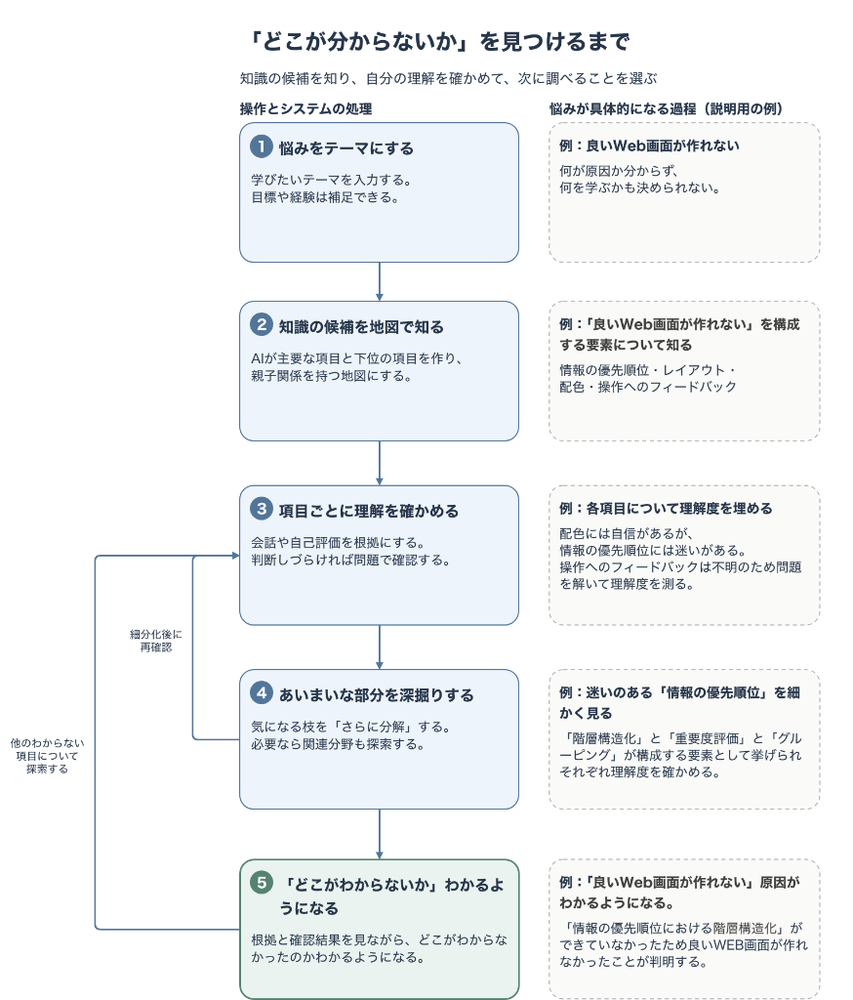
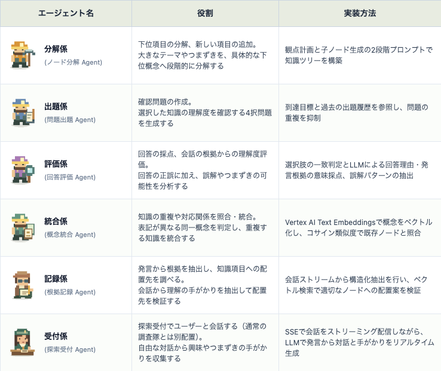

# IntellectusMap ~知図~ ― 「何がわからないかわからない」を「ここがわからない」へ

## 1. はじめに

みなさんは、何かを学んだり、理解しようとしたりするとき、「何がわからないのかわからない」と感じたことはないでしょうか。

例えば、こんな経験です。

- よいWeb画面を作りたいけれど、何を改善すればよいのかわからない。
- 確率・統計を勉強しているけれど、どこで理解がつまずいているのかわからない。
- GCPを使ったシステムを設計したいけれど、どのような知識が必要なのかわからない。

「わからない」「できない」という実感はあっても、その原因がどこにあるのかはわからない。

Web画面なら、配色なのか、レイアウトなのか、情報設計なのか。  
確率・統計なら、確率変数なのか、確率分布なのか、推定や検定なのか。

自分に足りない知識がわからなければ、何を学ぶべきかも判断できません。また、そもそも自分が知らない知識の存在に気づいていないこともあります。

**「何がわからないかわからない」を、「ここがわからない」へ。**

**「IntellectusMap ~知図~」** は、知識のつながりを地図として可視化し、自分の理解とその先にある未知の知識を探索するためのアプリです。

## 2. アプリ紹介動画

<!-- 動画公開後にYouTubeのURLを単独行で貼ります -->

## 3. 知識と理解を探索する

**「何がわからないのかわからない」。**

何かを理解しようとするとき、この状態が大きな壁になることがあります。

わからないことが明確であれば、それについて調べたり、学んだりすることができます。しかし、何がわからないのかさえ把握できていなければ、何を調べればよいのかも判断できません。

さらに厄介なのは、自分が何を理解していないのかを正確に把握すること自体が難しいという点です。

ある分野について「理解している」と思っていても、詳しく掘り下げてみると、説明できないことや、曖昧なままにしていたことが見つかる場合があります。

一方で、「よくわからない」と感じていることでも、そのすべてを理解していないわけではありません。すでに理解している部分もあれば、特定の知識が不足しているだけの場合もあります。

そして、そもそも存在すら知らない知識については、自分が理解していないことに気づくことさえできません。

**自分が何を理解していて、何を理解していないのか。その境界を把握することは、想像以上に難しいのです。**

例えば「良いWeb画面を作る」というテーマについて、配色やレイアウトの知識は思い浮かんでも、その奥にある視覚的階層や視線誘導といった概念までは意識していないかもしれません。

また、Webデザインとは異なる分野である認知心理学や人間工学にも、画面づくりにつながる知識が存在します。

このように、知識は一つひとつが独立しているのではなく、階層的な構造を持ち、異なる分野とも複雑につながっています。

そして、そのつながりの先には、まだ自分が知らない知識が広がっています。

こうした知識の世界を理解するには、個々の知識を覚えるだけでなく、**知識同士がどのようにつながり、その中で自分が何を理解しているのかを把握すること**が重要です。

何かを学ぶための教材は、書籍や解説記事、動画、オンライン講座など、すでに数多く存在しています。

しかし、学ぶための手段が豊富にあっても、自分に何の知識が足りないのかがわからなければ、何を学べばよいのかを判断することはできません。

**IntellectusMapは、新たな学習教材を提供することを目的としていません。**

知識を学ぶための「方法」ではなく、その前段階にある「何を学ぶべきか」を発見すること。そこにIntellectusMapの役割があります。

例えば、AIとのチャットでは、質問を重ねることで個々の疑問を解消し、知識を深めることができます。しかし、会話を通じて得られた知識の全体像や、自分がどこまで理解しているのかを把握することは簡単ではありません。また、存在自体を知らない知識については、そもそも質問することも難しいものです。

そこでIntellectusMapでは、知識の構造と自分の理解の状態を、一つの「地図」として可視化します。

地図を探索するように、一つの知識を深く掘り下げたり、そこから関連する別の知識へと進んだりすることで、これまで気づかなかった知識を発見していきます。

そして、探索を通じて知識のつながりが明らかになるにつれ、自分が理解している部分と、理解できていない部分も少しずつ見えてきます。

「ここがわからない」という発見と、「こんな知識があったのか」という発見。

この2つの発見を重ねることで、自分の理解の輪郭が明らかになり、次に何を学ぶべきかを考える手がかりが得られます。

IntellectusMapは、自分の理解を見渡し、次にどこへ進むべきかを自分で決めるための「知識の地図」を提供します。

## 4. アプリの使い方

ここからは、IntellectusMapで実際に知識を探索する流れを紹介します。

<p align="center">
  
</p>

### ① テーマを入力する

まずは、探索したいテーマを入力します。

例えば「React状態管理」「機械学習の基礎」「良いWeb画面を作る方法」など、具体的な技術から漠然とした課題まで、さまざまなテーマを設定できます。

任意で、対象とする範囲や前提レベル、除外したい内容も指定できます。

### ② 探索受付と会話して、地図を作る

調査手帳の「探索受付」に、やってみたこと、知っていること、つまずいたことを自由に話します。

AIが会話から知識の項目と理解の手がかりを抽出し、地図へ反映していきます。

例えば「良いWeb画面を作る」というテーマなら、配色、レイアウト、情報設計といった項目が地図上に現れます。

地図は、最初からすべての知識が表示されるわけではありません。はじめはテーマ直下の項目が表示され、気になる枝を選んだり展開したりすることで、段階的に探索範囲を広げられます。

### ③ 自分の理解度を確認する

地図上の項目を選ぶと、調査手帳にその知識の詳細が表示されます。

理解度を確認する方法は主に2つあります。

- **自己評価**：自分の感覚に合わせて理解度を選択します。
- **理解度チェック問題**：「問題で理解度を確認する」を選ぶと4択問題が出題され、回答に応じた解説と判定が行われます。

また、探索受付との会話からも、理解度を推定するための手がかりを収集します。

これらの情報をもとに、AIが項目ごとの理解度を推定し、その状態を地図上の建物や地形として表現します。

| 理解の状態 | 地図上の建物 |
| --- | --- |
| 高 | 完成した拠点 |
| 中 | 建設途中の小屋 |
| 低 | 仮設テント |
| 未確認 | 未調査の石碑 |

「未確認」は、理解度を判断するための材料がまだない状態です。

理解度が低い項目と未確認の項目を区別することで、学び直したい知識と、まず理解を確かめたい知識を見分けられます。

また、旗によって判定の信頼度も表示します。


なお、地図に表示される理解度は、AIが会話や回答などの情報から推定したものであり、必ずしも実際の理解と一致するわけではありません。

そのため、理解度と判定の信頼度を分けて扱い、調査手帳では判断の根拠や回答履歴を確認できるようにしています。

学習後に再び理解度を確認すれば、新しい判断材料を地図へ反映し、自分の理解の変化を振り返ることもできます。

### ④ 知識を深掘りする

IntellectusMapでは、知識を探索する方法の一つとして「深掘り」があります。

深掘りでは、一つの知識をより細かな知識へと段階的に分解していきます。

例えば「レイアウト」を掘り下げることで、「視覚的階層」や「視線誘導」といった、より具体的な概念を探索できます。

さらに「視覚的階層」を掘り下げることで、その奥にある設計原則や考え方へと探索を進められます。

分解には、主に次の方法があります。

- つまずきや誤答があった項目について、AIが原因となり得る下位概念を自動的に分解します。
- 手動で詳しく調べたい項目は、「分割エージェントで分解」から細分化できます。
- 探索受付との会話を続けることでも、新しい知識の項目を追加できます。

例えば「情報設計」について理解が曖昧でも、さらに掘り下げてみると、「利用者の目的を整理すること」は理解できていて、「情報の優先順位を判断すること」でつまずいているとわかるかもしれません。

このように、深掘りは未知の知識を発見するだけでなく、自分の理解がどこで曖昧になっているのかを、より具体的に把握することにもつながります。

### ⑤「繋がりMAP」で関連探索する

知識を探索するもう一つの方法が「関連探索」です。

深掘りが一つの知識の奥へと進む探索であるのに対して、関連探索では、ある知識を起点として、別の知識や分野とのつながりを探します。

例えば「Webデザイン」から「認知心理学」へ、さらにそこから別の分野へと探索を広げることができます。

IntellectusMapでは、次のような操作で関連探索を進めます。

- 項目やマップから「このMAPから繋がりを探す（知識を広げる）」を選ぶと、AIが関連するテーマ候補を放射状に提示します。
- 気になる候補から「このテーマで深掘りを始める」を選ぶと、新しい地図が派生し、元のテーマとのつながりが保存されます。
- 画面上部の「繋がりMAP」では、複数のテーマがどのように関係しているかを俯瞰できます。
- 過去の地図一覧（知識マップ）や知識ノード一覧から、これまでに探索した知識を横断的に確認できます。

こうして、一つのテーマから始まった探索が、思いもよらなかった別の分野へとつながっていきます。

**「深掘り」と「関連探索」。**

この2つを行き来しながら知識を探索することで、知識のつながりを広げるとともに、自分の理解の状態を少しずつ明らかにしていきます。

## 5. システム構成

IntellectusMapは、Google Cloudのサーバレスアーキテクチャと、Cloud Run上で動作する **マルチAIエージェント層** で構成しています。

フロントエンドにはReact、バックエンドにはFastAPIを採用し、AIによる知識の構造化や理解度の推定にはVertex AIのGeminiを利用しています。


### 5.1 AIエージェント層（マルチエージェント協調）

IntellectusMapでは、単一のプロンプトですべてを処理するのではなく、役割ごとに特化した6つのAIエージェントを組み合わせています。

知識の分解、概念の統合、理解度の評価、関連知識の探索などは、それぞれ異なる性質を持つ処理です。

例えば、知識を分解する処理では、その概念に含まれる知識を適切な粒度で整理する必要があります。一方、概念を統合する処理では、すでに存在する知識との意味的な重複を判断する必要があります。

こうした異なる役割を分離することで、知識の構造化から理解度の推定までを、複数のエージェントが協調して処理する構成としています。

<p align="center">
  
</p>

| エージェント名 | 役割 | 実装方法 |
| --- | --- | --- |
| **分解係**（ノード分解） | 下位項目の分解、新しい項目の追加。大きなテーマやつまずきを具体的な下位概念へ段階的に分解する | 観点計画と子ノード生成の2段階プロンプトで知識ツリーを構築 |
| **出題係**（問題出題） | 確認問題の作成。選択した知識の理解度を確認する4択問題を生成する | 到達目標と過去の出題履歴を参照し、問題の重複を抑制 |
| **評価係**（回答評価） | 回答の採点、会話の根拠からの理解度評価。回答の正誤に加え、誤解やつまずきの可能性を分析する | 選択肢の一致判定とLLMによる回答理由・発言根拠の意味採点、誤解パターンの抽出 |
| **統合係**（概念統合） | 知識の重複や対応関係を照合・統合。表記が異なる同一概念を判定し、重複する知識を統合する | Vertex AI Text Embeddingsで概念をベクトル化し、コサイン類似度で既存ノードと照合 |
| **記録係**（根拠記録） | 発言から根拠を抽出し、知識項目への配置先を調べる。会話から理解の手がかりを抽出して配置先を検証する | 会話ストリームから構造化抽出を行い、ベクトル検索で適切なノードへの配置案を検証 |
| **受付係**（探索受付） | 探索受付でユーザーと会話する（通常の調査隊とは別配置）。自由な対話から興味やつまずきの手がかりを収集する | SSEで会話をストリーミング配信しながら、LLMで発言から対話と手がかりをリアルタイム生成 |

### 5.2 知識の分解と統合

IntellectusMapの中心となる処理の一つが、知識の分解と統合です。

例えば「Web画面づくり」という大きなテーマをそのまま理解度の評価対象にしても、何を理解していて、何がわからないのかを細かく把握することはできません。

そのため、ノード分解 Agentがテーマを複数の観点から整理し、より具体的な知識へ分解します。

一方で、分解を繰り返すと、異なる経路から同じ概念が生成されることがあります。

例えば「UI設計」と「画面設計」のように、表現は異なっていても、扱う内容が重なる場合があります。

そこで概念統合 Agentが、概念名称の埋め込みベクトルを用いて既存ノードとの類似度を照合し、同一概念かどうかを判定します。

**知識を細かく分解することと、重複する知識を統合すること。**

この2つの処理を組み合わせることで、単に項目が増えていくだけではなく、知識同士の関係を整理した地図の構築を目指しています。

### 5.3 理解度の推定

IntellectusMapでは、自己評価だけでなく、会話内容や確認問題への回答も理解度の推定に利用します。

例えば、ユーザーが「この分野は理解している」と申告した場合、その情報だけで理解度が高いと確定するのではなく、暫定的な判断材料として扱います。

また、確認問題では単なる正誤だけでなく、回答理由や誤解の可能性も分析します。

こうして集めた情報をもとに理解度を推定し、判定の信頼度とともに地図へ反映します。

重要なのは、**理解度の推定結果と、その推定をどの程度信頼できるかを区別すること**です。

AIによる評価には不確実性があるため、判定理由や根拠を確認できる仕組みを設けています。

### 5.4 インフラ

#### Cloud Run

バックエンドAPIおよびAIエージェント群をコンテナで実行します。

リクエストに応じた自動スケーリングを利用し、常時稼働コストを抑えられる構成としています。

#### Firestore

ユーザーセッション、知識マップ、概念ノード、診断履歴、埋め込みベクトルなどのデータを永続化します。

#### Firebase Hosting

Reactで構築したSPAフロントエンドを配信します。

#### Vertex AI（Gemini & Text Embeddings）

各エージェントの推論エンジンとしてGeminiを利用しています。

また、Text Embeddings APIで概念をベクトル化し、知識ノード間の類似度照合に活用しています。

### 5.5 バックエンドAPI

技術スタックは **FastAPI** を利用しています。

主な機能は以下の通りです。

- SSE（Server-Sent Events）による対話とエージェント処理進捗のストリーミング
- AIエージェントの実行とデータ＆キャッシュ管理

AIの処理には時間がかかる場合があるため、会話や処理状況をストリーミングし、ユーザーが進行状況を確認できるようにしています。

### 5.6 フロントエンド

技術スタックは **React 19 / TypeScript / Vite / d3-force / React Flow** です。

主な機能は以下の通りです。

- RPG調の「理解の地図」（SVG等高線地形 + d3-force物理配置エンジン）
- 調査手帳（探索受付・問題回答・調査記録・対話ログ）
- エージェントのリアルタイム稼働状態（調査隊アニメーション）
- 分野横断を可視化する「繋がりMAP」（React Flowによる放射状ネットワーク表示）

知識同士のつながりを直感的に把握できるよう、地図の配置にはd3-forceによる力指向レイアウトを使用しています。

また、理解度を単なる数値や色だけでなく、建物や地形の変化として表現することで、地図を探索する体験と理解の状態を結びつけています。

## 6. 今後の展望

IntellectusMapでは、知識の構造化、理解度の可視化、深掘りと関連探索を組み合わせた知識探索の仕組みを実装しました。

一方で、自分の理解をより正確に把握し、未知の知識をより自然に探索するためには、改善できる部分も多くあります。

### 知識の構造化の精度向上

知識の分解には、適切な粒度や概念同士の関係性を判断する難しさがあります。

同じ概念でも、テーマや文脈によって適切な分解の仕方は異なります。また、知識同士の関係も、必ずしも単純な親子関係だけで表現できるわけではありません。

今後は、こうした違いをより柔軟に扱い、自然で一貫した知識構造を生成できるよう改善していきたいと考えています。

### 理解度推定の精度向上

現在の理解度は、会話や自己評価、確認問題をもとに推定しています。

しかし、一度の回答だけでは、その知識を本当に理解しているのか、たまたま正解したのかを十分に判断できない場合があります。

今後は、異なる形式の問題や、時間を空けた再確認なども活用し、より多角的に理解の状態を把握できる仕組みを検討したいと考えています。

### 知識同士の関係性の拡充

知識の関係には、ある概念に含まれる知識だけでなく、前提となる知識、応用先となる知識、別の分野との関連など、さまざまな種類があります。

こうした関係性をより明確に扱うことで、知識の地図を単なる階層構造ではなく、複雑につながる知識のネットワークとして発展させられると考えています。

## 7. まとめ

私たちは、自分が何を理解していて、何を理解していないのかを、必ずしも正確に把握できているわけではありません。

理解しているつもりの知識にも曖昧な部分があり、まだ存在すら知らない知識もあります。

そして、それらの知識は独立して存在するのではなく、互いにつながり合っています。

**IntellectusMap ~知図~** は、こうした知識のつながりと自分の理解の状態を地図として可視化し、その中を探索するためのアプリです。

知識を深く掘り下げたり、別の知識とのつながりをたどったりすることで、これまで知らなかった知識に出会い、自分の理解がどこまで及んでいるのかを確かめていきます。

**「ここがわからない」という発見と、「こんな知識があったのか」という発見。**

この2つの発見を繰り返しながら、自分の理解の輪郭を少しずつ明らかにしていく。

IntellectusMapが、そんな知識探索の一助になれば幸いです。

最後までお読みいただき、ありがとうございました。

---

## 8. 環境構築・ローカル実行

本リポジトリを手元で動かす手順は以下の通りです。詳細な操作手順やマニュアルは [IntellectusMap マニュアル一覧](output/pdf/README.md) を参照してください。

```bash
# 仮想環境作成と依存関係インストール
python3 -m venv .venv
.venv/bin/pip install -r backend/requirements.lock
npm --prefix frontend ci
cp .env.example .env

# バックエンド起動 (Terminal 1)
.venv/bin/uvicorn app.main:app --app-dir backend --host 127.0.0.1 --port 8000 --reload

# フロントエンド起動 (Terminal 2)
npm --prefix frontend run dev
```

- Web画面: http://localhost:5173
- APIドキュメント (Swagger UI): http://127.0.0.1:8000/docs
- ヘルスチェック: http://127.0.0.1:8000/api/health
