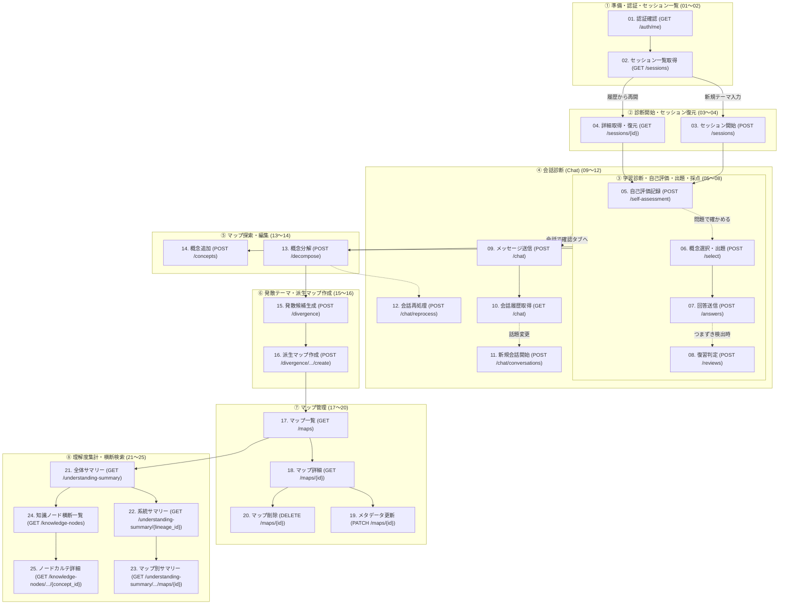

# API仕様書 一覧・呼び出しタイミング定義書

本ドキュメントは、システムが提供する**全25本のWeb API**の概要、および**ユーザーの作業進行順（ライフサイクルフロー順）**に応じた呼び出しタイミング（画面遷移・ユーザーアクション・トリガー）を整理した総合インデックスである。

---

## 1. ユーザー作業順 API一覧インデックス

本システムは、学習者が「認証確認」から始まり、「テーマ入力・初期診断」「出題・回答」「会話診断」「マップ探索・編集」「発散派生」「横断分析」に至る一連の学習体験を提供しており、APIの設計および配置もこの**ユーザーの自然な作業順**に準拠している。

### フェーズ1: 準備・認証・セッション一覧 (01〜02)
学習の前提となるユーザー認証状態の検証、過去の診断履歴一覧の確認。

| 番号 | API名 | メソッド | エンドポイント | 呼び出しタイミング（画面・トリガー） | 仕様書リンク |
|:---:|:---|:---:|:---|:---|:---:|
| **01** | 認証状態取得 | `GET` | `/api/auth/me` | **【初期アクセス・認証確認】** ・画面アクセス時のトークン有効性検証 ・現在のユーザーID・ゲスト状態の取得 | [01_認証状態取得API.md](./01_認証状態取得API.md) |
| **02** | 診断セッション一覧取得 | `GET` | `/api/sessions` | **【履歴確認・初期表示】** ・ログイン後、左側サイドバー「診断履歴」パネルの展開・ロード時 | [02_診断セッション一覧取得API.md](./02_診断セッション一覧取得API.md) |

---

### フェーズ2: 診断開始・セッション復元 (03〜04)
学習テーマの入力、初期知識マップの自動生成、過去セッションの画面復元。

| 番号 | API名 | メソッド | エンドポイント | 呼び出しタイミング（画面・トリガー） | 仕様書リンク |
|:---:|:---|:---:|:---|:---|:---:|
| **03** | 診断セッション開始 | `POST` | `/api/sessions` | **【診断開始】** ・テーマ入力フォームでテーマ・文脈を入力し、「診断をはじめる」を押下した時 (SSE対応) | [03_診断セッション開始API.md](./03_診断セッション開始API.md) |
| **04** | 診断セッション詳細取得 | `GET` | `/api/sessions/{session_id}` | **【セッション復元・同期】** ・サイドバー履歴から過去診断を選択した時 ・画面リロード（F5）時の状態復元・ポーリング時 | [04_診断セッション詳細取得API.md](./04_診断セッション詳細取得API.md) |

---

### フェーズ3: 学習診断・自己評価・出題・採点 (05〜08)
自己評価の入力、問題の出題、回答送信、およびつまずき発生時の復習判断。

| 番号 | API名 | メソッド | エンドポイント | 呼び出しタイミング（画面・トリガー） | 仕様書リンク |
|:---:|:---|:---:|:---|:---|:---:|
| **05** | 概念自己評価 | `POST` | `/api/sessions/{session_id}/self-assessment` | **【自己申告】** ・ノード選択時、問題回答を省略して自己評価ボタン（理解/あいまい/分からない）を押下した時 | [05_概念自己評価API.md](./05_概念自己評価API.md) |
| **06** | 概念選択・出題 | `POST` | `/api/sessions/{session_id}/select` | **【問題出題要求】** ・ツリー上の概念ノードを選択し、「問題で理解度を確認する」ボタンを押下した時 (SSE対応) | [06_概念選択・出題API.md](./06_概念選択・出題API.md) |
| **07** | 問題回答送信 | `POST` | `/api/sessions/{session_id}/answers` | **【解答・自動採点】** ・4択または記述問題に回答を入力し、「回答して次へ」を押下した時 (SSE対応) | [07_問題回答送信API.md](./07_問題回答送信API.md) |
| **08** | 回答復習判定 | `POST` | `/api/sessions/{session_id}/reviews` | **【弱点確認・意思決定】** ・誤答分析パネルで「分からない箇所が分かった（終了）」または「まだ分からない（続行）」を押下時 | [08_回答復習判定API.md](./08_回答復習判定API.md) |

---

### フェーズ4: 会話診断（Chat）(09〜12)
問題形式だけでなく、自然なチャット対話を通じて理解の輪郭を言語化・抽出するフロー。

| 番号 | API名 | メソッド | エンドポイント | 呼び出しタイミング（画面・トリガー） | 仕様書リンク |
|:---:|:---|:---:|:---|:---|:---:|
| **09** | 会話メッセージ送信 | `POST` | `/api/sessions/{session_id}/chat` | **【自由対話】** ・「会話で確認」タブでユーザーが発言を送信した時 (SSEリアルタイムストリーミング) | [09_会話メッセージ送信API.md](./09_会話メッセージ送信API.md) |
| **10** | 会話診断履歴取得 | `GET` | `/api/sessions/{session_id}/chat` | **【会話履歴表示】** ・「会話で確認」タブを開いた時、または過去の発言ログと抽出根拠を確認する時 | [10_会話診断履歴取得API.md](./10_会話診断履歴取得API.md) |
| **11** | 新規会話セッション開始 | `POST` | `/api/sessions/{session_id}/chat/conversations` | **【話題切替】** ・会話パネルで新しい話題や別の概念に焦点を変えて対話をリセット・開始する時 | [11_新規会話セッション開始API.md](./11_新規会話セッション開始API.md) |
| **12** | 会話再処理 | `POST` | `/api/sessions/{session_id}/chat/reprocess` | **【エビデンス再評価】** ・ノード分解・追加後に、過去の会話ログを再スキャンして新規ノードへの根拠を再抽出する時 | [12_会話再処理API.md](./12_会話再処理API.md) |

---

### フェーズ5: マップ探索・編集 (13〜14)
ツリーのさらなる細分化（オンデマンド分解）、手動概念追加。

| 番号 | API名 | メソッド | エンドポイント | 呼び出しタイミング（画面・トリガー） | 仕様書リンク |
|:---:|:---|:---:|:---|:---|:---:|
| **13** | 概念分解 | `POST` | `/api/sessions/{session_id}/decompose` | **【ノード細分化】** ・概念ノード選択時、「さらに分解」ボタンを押下して下位概念を生成した時 (SSE対応) | [13_概念分解API.md](./13_概念分解API.md) |
| **14** | 概念手動追加 | `POST` | `/api/sessions/{session_id}/concepts` | **【概念手動追加】** ・ノード追加フォームで独自の概念名と説明を入力し、「追加する」を押下した時 | [14_概念手動追加API.md](./14_概念手動追加API.md) |

---

### フェーズ6: 発散テーマ・派生マップ作成 (15〜16)
興味のある概念から派生トピックを広げ、新しい深掘りマップへ展開する。

| 番号 | API名 | メソッド | エンドポイント | 呼び出しタイミング（画面・トリガー） | 仕様書リンク |
|:---:|:---|:---:|:---|:---|:---:|
| **15** | 発散候補生成 | `POST` | `/api/maps/{map_id}/concepts/{concept_id}/divergence` | **【新テーマ提案】** ・ノード詳細から「知識を広げる」を押下し、関連トピック候補をAI生成した時 (SSE対応) | [15_発散候補生成API.md](./15_発散候補生成API.md) |
| **16** | 発散マップ作成 | `POST` | `/api/maps/{map_id}/concepts/{concept_id}/divergence/{candidate_id}/create` | **【派生マップ開始】** ・提案された発散候補から1つを選択し、「派生マップを作成」を押下した時 (SSE対応) | [16_発散マップ作成API.md](./16_発散マップ作成API.md) |

---

### フェーズ7: マップ管理 (17〜20)
作成済み知識マップの一覧、詳細、メタデータ編集および削除。

| 番号 | API名 | メソッド | エンドポイント | 呼び出しタイミング（画面・トリガー） | 仕様書リンク |
|:---:|:---|:---:|:---|:---|:---:|
| **17** | マップ一覧取得 | `GET` | `/api/maps` | **【マップ一覧表示】** ・上部ナビゲーション「深掘りマップ一覧」タブを開いた時 | [17_マップ一覧取得API.md](./17_マップ一覧取得API.md) |
| **18** | マップ詳細取得 | `GET` | `/api/maps/{map_id}` | **【マップ詳細表示】** ・マップ一覧から特定のマップカードを選択・表示した時 | [18_マップ詳細取得API.md](./18_マップ詳細取得API.md) |
| **19** | マップメタデータ更新 | `PATCH` | `/api/maps/{map_id}` | **【マップ情報編集】** ・マップのタイトルやメモを編集・保存した時 | [19_マップメタデータ更新API.md](./19_マップメタデータ更新API.md) |
| **20** | マップ削除 | `DELETE` | `/api/maps/{map_id}` | **【マップ破棄】** ・マップ一覧・詳細で「マップを削除する」ボタンを押下し承認した時 | [20_マップ削除API.md](./20_マップ削除API.md) |

---

### フェーズ8: 理解度サマリー集計・知識ノード横断検索 (21〜25)
全体・系統・マップ別のロールアップ集計ダッシュボード、全マップ横断でのノードカルテ検索。

| 番号 | API名 | メソッド | エンドポイント | 呼び出しタイミング（画面・トリガー） | 仕様書リンク |
|:---:|:---|:---:|:---|:---|:---:|
| **21** | 理解度サマリー全体取得 | `GET` | `/api/understanding-summary` | **【ダッシュボード全体表示】** ・全系統・全マップを通じた学習者の総合理解度メトリクスを表示する時 | [21_理解度サマリー全体取得API.md](./21_理解度サマリー全体取得API.md) |
| **22** | 系統別理解度サマリー取得 | `GET` | `/api/understanding-summary/{lineage_id}` | **【系統別集計】** ・繋がりMAPで特定の系統を選択し、重複を排除した統合理解度を表示する時 | [22_系統別理解度サマリー取得API.md](./22_系統別理解度サマリー取得API.md) |
| **23** | マップ別理解度サマリー取得 | `GET` | `/api/understanding-summary/{lineage_id}/maps/{map_id}` | **【単一マップ集計】** ・特定マップ単体の理解度集計メトリクス（青・黄・赤ノード内訳）を表示する時 | [23_マップ別理解度サマリー取得API.md](./23_マップ別理解度サマリー取得API.md) |
| **24** | 知識ノード横断一覧取得 | `GET` | `/api/knowledge-nodes` | **【横断検索・フィルタ】** ・「知識ノード一覧」タブを開いた時、または検索バー入力・理解度絞り込み時 | [24_知識ノード横断一覧取得API.md](./24_知識ノード横断一覧取得API.md) |
| **25** | 知識ノード詳細取得 | `GET` | `/api/knowledge-nodes/{map_id}/{concept_id}` | **【ノードカルテ閲覧】** ・横断ノード一覧から行をクリックし、エビデンスや他マップ共有状況を表示した時 | [25_知識ノード詳細取得API.md](./25_知識ノード詳細取得API.md) |

---

## 2. ユーザー作業順 全体ライフサイクルフロー図

