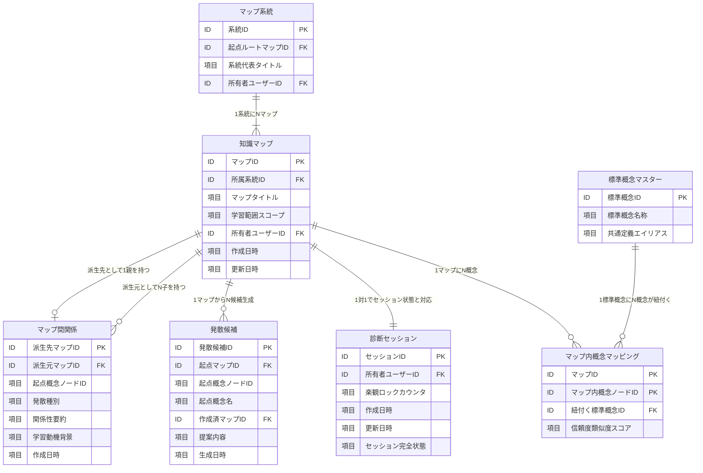

# データベース定義書（Cloud Firestore）

## 1. 概要

- **採用技術**: Google Cloud Firestore (Native NoSQL Mode)
- **データ管理方針**:
  - 診断・探索状態の本体は「診断セッション（`sessions`）」ドキュメント内にツリー構造・履歴を包含して完全保持（アトミックな更新・高凝集性）。
  - マップ一覧・系統樹・発散リレーション・標準概念は個別コレクションへ展開し、高速な検索・集計・データ分離を実現。
  - すべてのデータは `user_id`（Google sub値）によりユーザーごとに完全分離。

### 1.1 コレクション一覧（論理名・物理名対応表）

| No | 論理名（日本語名） | 物理名（コレクション名） | 具体的に保持するデータ・役割 | 具体例・活用シーン |
| --- | --- | --- | --- | --- |
| 1 | **診断セッション** | `sessions` | **診断・学習中の完全な進行状態データ** ・知識ノード群と親子依存関係（ツリー構造） ・各ノードの客観的理解度スコア（4択正答状況） ・現在出題中の4択クイズ・選択肢、過去の回答履歴 | 「Docker基礎」診断中のノード木構造、出題中の第3問、過去の正誤判定履歴 |
| 2 | **知識マップ** | `maps` | **マップ一覧や切替表示用のヘッダー基本情報** ・マップの表示タイトル、学習対象スコープ ・所属する系統ID、所有者ユーザーID、作成・更新日時 | 「Python非同期処理入門」「スコープ: asyncioとイベントループの理解」というマップ管理情報 |
| 3 | **マップ系統** | `lineages` | **ルートから派生した一連のマップ群を束ねる系統樹グループ** ・起点となった最初のルートマップID ・系統全体の代表タイトル、所有者ユーザーID | 起点「Web開発全般」から「Frontend」「Backend」「DevOps」と枝分かれしたツリー全体の包括データ |
| 4 | **マップ間関係** | `relations` | **親マップの特定ノードと子マップを結ぶ接続線データ** ・親マップID、起点となった親概念ノードID ・派生種別（実務応用・深掘り・隣接・リスク）、派生理由 | 親マップ「認証・認可」の「JWT」ノードから、子マップ「OAuth 2.0フロー」へ派生した親子接続関係 |
| 5 | **発散候補** | `divergence_candidates` | **AIが提案した「次に学べる発展テーマ」の提案カード一覧** ・起点マップID、起点概念ノードID、起点概念名 ・4観点の提案タイトル、学習スコープ、学習価値・理由 | 「FastAPI」ノードをクリックした際にAIが提案した「非同期DBアクセス」「Pydantic実践」等の未作成候補 |
| 6 | **標準概念マスター** | `canonical_concepts` | **マップを跨いで登場する同義・類似概念を統一する共通辞書** ・標準化された代表概念名 ・別名・エイリアス一覧、共通定義データ | 「JWT」「JSON Web Token」「ウェブトークン」を同一の概念キーとして集約管理する辞書データ |
| 7 | **マップ内概念マッピング** | `map_concept_relations` | **各マップ内のノードと標準概念マスターを結ぶ照合データ** ・対象マップID、マップ内概念ノードID ・紐付く標準概念ID、LLM類似度スコア | マップAの「トークン認証」ノードが標準概念「JWT」と類似度0.95で一致し、既習判定に引き継がれる情報 |

---

## 2. ER図（コレクション関連図）

---

## 3. コレクション・フィールド定義

### 3.1 診断セッション（`sessions`）コレクション

| 項目 | 内容 |
| --- | --- |
| **論理名（日本語名）** | 診断セッション |
| **物理名（コレクション名）** | `sessions` |
| **ドキュメントID** | `sessionId` (UUID) |
| **説明** | **学習者が受けている診断中の完全な進行状態データ**を管理する。 ・知識ノード群と親子依存関係（ツリー構造全体） ・各ノードの客観的理解度スコア（4択テスト判定結果） ・現在出題中の4択クイズ問題・選択肢、および過去の回答・正誤履歴 画面上でのクイズ回答やノード選択に応じてリアルタイムに更新される中心データ。 |

#### フィールド定義 (`sessions/{sessionId}`)
| フィールド名 | データ型 | 必須 | 説明 |
| --- | --- | --- | --- |
| `session_id` | string | ○ | セッション一意識別子 (UUID) |
| `user_id` | string | ○ | セッション所有者のGoogle sub識別子 |
| `revision` | number | ○ | 楽観的排他制御用カウンタ (更新ごとにインクリメント) |
| `created_at` | timestamp / string | ○ | 作成日時 (ISO8601) |
| `updated_at` | timestamp / string | ○ | 更新日時 (ISO8601) |
| `payload` | map | ○ | セッション状態オブジェクト |
| └ `topic` | string | ○ | 診断テーマ・タイトル |
| └ `goal` | string | - | 学習目標・目的 |
| └ `status` | string | ○ | セッション状態 (`in_progress`, `completed`, `stopped`) |
| └ `active_concept_id`| string | - | 現在診断中の概念ノードID |
| └ `tree` | map | ○ | 知識ノードおよびエッジ木構造 |
| 　└ `root_id` | string | ○ | 起点ルートノードID |
| 　└ `nodes` | map | ○ | 各概念ノードのマップ (`concept_id` -> ノード情報) |
| 　└ `edges` | array<map> | ○ | 概念間の依存・包含エッジ配列 |
| └ `history` | array<map> | ○ | 4択出題・回答・正誤評価履歴リスト |
| └ `current_question` | map | - | 現在出題中の4択診断問題オブジェクト |
| └ `policy` | map | ○ | 診断進行ポリシーパラメータ |
| └ `chat` | map | ○ | 会話診断状態オブジェクト (`ChatState`) |
| 　└ `current_conversation_id` | string | ○ | 現在アクティブな会話スレッドID |
| 　└ `conversations` | array<map> | ○ | 会話スレッド一覧 (`conversation_id`, `title`, `created_at`) |
| 　└ `messages` | array<map> | ○ | 送受信メッセージ履歴 (`message_id`, `role`, `content`, `status`, `created_at`) |
| 　└ `observations` | array<map> | ○ | 会話から抽出された観察エビデンス (`concept_id`, `score`, `confidence`, `citations`, `kind`) |
| 　└ `experience_units` | array<map> | ○ | 発言から分解された経験単位 (`topic`, `statement`, `kind`, `citations`) |
| 　└ `evidence_queue` | array<map> | ○ | 未処理・判定待ちエビデンスキュー |
| 　└ `jobs` | array<map> | ○ | バックグラウンド処理ジョブ一覧 (`turn_id`, `status`, `phase`) |

#### インデックス定義
- **単一フィールドインデックス**: `user_id` (ASC)
- **複合インデックス**: `user_id` (ASC) + `updated_at` (DESC)

---

### 3.2 知識マップ（`maps`）コレクション

| 項目 | 内容 |
| --- | --- |
| **論理名（日本語名）** | 知識マップ |
| **物理名（コレクション名）** | `maps` |
| **ドキュメントID** | `mapId` (UUID) |
| **説明** | **作成済みマップのメタデータ（ヘッダー基本情報）**を管理する。 ・マップの表示タイトル、学習対象スコープの説明文 ・所属する系統樹ID、所有者ユーザーID、作成・更新日時 画面の「マップ一覧（サイドバー）」や系統樹ビューのカード一覧として参照される。 |

#### フィールド定義 (`maps/{mapId}`)
| フィールド名 | データ型 | 必須 | 説明 |
| --- | --- | --- | --- |
| `map_id` | string | ○ | マップ一意識別子 (UUID) |
| `lineage_id` | string | ○ | 所属する系統樹識別子 (`lineages/{lineageId}`) |
| `title` | string | ○ | マップ表示タイトル |
| `scope` | string | - | 学習範囲・対象領域の説明文 |
| `created_at` | timestamp / string | ○ | 作成日時 (ISO8601) |
| `updated_at` | timestamp / string | ○ | 更新日時 (ISO8601) |
| `user_id` | string | ○ | 所有者ユーザー識別子 (Google sub値) |

#### インデックス定義
- **単一フィールドインデックス**: `user_id` (ASC), `lineage_id` (ASC)
- **複合インデックス**: `user_id` (ASC) + `updated_at` (DESC)

---

### 3.3 マップ系統（`lineages`）コレクション

| 項目 | 内容 |
| --- | --- |
| **論理名（日本語名）** | マップ系統 |
| **物理名（コレクション名）** | `lineages` |
| **ドキュメントID** | `lineageId` (UUID) |
| **説明** | **起点となった最初のルートマップと、そこから枝分かれして作成された一連の派生マップ群を束ねる系統樹グループ情報**を管理する。 ・起点ルートマップID、系統全体の代表タイトル、所有者ユーザーID ユーザーがどの学習テーマから始めてどこへ分岐していったかの全体像（家系図）を保持する。 |

#### フィールド定義 (`lineages/{lineageId}`)
| フィールド名 | データ型 | 必須 | 説明 |
| --- | --- | --- | --- |
| `lineage_id` | string | ○ | 系統一意識別子 (UUID) |
| `root_map_id` | string | ○ | 起点となったルートマップID |
| `title` | string | ○ | 系統全体の代表タイトル |
| `user_id` | string | ○ | 所有者ユーザー識別子 (Google sub値) |

#### インデックス定義
- **単一フィールドインデックス**: `user_id` (ASC), `root_map_id` (ASC)

---

### 3.4 マップ間関係（`relations`）コレクション

| 項目 | 内容 |
| --- | --- |
| **論理名（日本語名）** | マップ間関係 |
| **物理名（コレクション名）** | `relations` |
| **ドキュメントID** | `targetMapId` (派生先マップID) |
| **説明** | **マップ同士を繋ぐ親子接続エッジ情報**を管理する。 ・親マップID、起点となった親マップ内の概念ノードID ・派生関係種別（実務応用・仕組み深掘り・隣接分野・リスク回避）、派生理由・学習動機 派生先マップが「親のどの知識から、なぜ分岐したのか」というコンテキストを保持する。 |

#### フィールド定義 (`relations/{targetMapId}`)
| フィールド名 | データ型 | 必須 | 説明 |
| --- | --- | --- | --- |
| `target_map_id` | string | ○ | 派生先マップID (ドキュメントIDと同一) |
| `source_map_id` | string | ○ | 派生元マップID (親) |
| `source_concept_id` | string | ○ | 派生元の起点概念ノードID |
| `category` | string | ○ | 発散関係種別 (`practical_application`, `underlying_mechanism`, `adjacent_field`, `troubleshooting_risk`) |
| `relation` | string | - | 関係性タイトル・要約 |
| `reason` | string | - | 学習動機・背景解説 |
| `created_at` | timestamp / string | ○ | リレーション作成日時 (ISO8601) |

#### インデックス定義
- **単一フィールドインデックス**: `source_map_id` (ASC), `category` (ASC)

---

### 3.5 発散候補（`divergence_candidates`）コレクション

| 項目 | 内容 |
| --- | --- |
| **論理名（日本語名）** | 発散候補 |
| **物理名（コレクション名）** | `divergence_candidates` |
| **ドキュメントID** | `candidateId` (UUID) |
| **説明** | **概念ノードを選択した際にLLMが提案した「次に学べる発展学習テーマ」の候補リスト（未作成マップ候補）**を管理する。 ・起点マップID、起点概念ノードID、起点概念名 ・4観点（実務応用・深掘り・周辺・リスク）の提案タイトル、学習スコープ、学習理由 ユーザーが新マップを作成するまでの選択肢カードとして保持される。 |

#### フィールド定義 (`divergence_candidates/{candidateId}`)
| フィールド名 | データ型 | 必須 | 説明 |
| --- | --- | --- | --- |
| `candidate_id` | string | ○ | 候補一意識別子 (UUID) |
| `source_map_id` | string | ○ | 提案元の起点マップID |
| `source_concept_id` | string | ○ | 提案元の起点概念ノードID |
| `source_concept_name`| string | - | 起点概念ノード表示名 |
| `target_map_id` | string | - | 実際に派生マップが作成された場合のマップID (未作成時はnull) |
| `created_at` | timestamp / string | ○ | 候補生成日時 (ISO8601) |
| `payload` | map | ○ | 候補データ詳細 |
| └ `title` | string | ○ | 提案マップタイトル |
| └ `category` | string | ○ | 発散種別 (`practical_application`, `underlying_mechanism`, `adjacent_field`, `troubleshooting_risk`) |
| └ `relation` | string | ○ | 親概念との関係性 |
| └ `scope` | string | ○ | 派生マップでカバーすべき学習スコープ |
| └ `reason` | string | ○ | 提案理由・学習価値 |

#### インデックス定義
- **単一フィールドインデックス**: `source_map_id` (ASC)
- **複合インデックス**: `source_map_id` (ASC) + `source_concept_id` (ASC) + `created_at` (DESC)

---

### 3.6 標準概念マスター（`canonical_concepts`）コレクション

| 項目 | 内容 |
| --- | --- |
| **論理名（日本語名）** | 標準概念マスター |
| **物理名（コレクション名）** | `canonical_concepts` |
| **ドキュメントID** | `canonicalId` (正規化文字列) |
| **説明** | **複数マップを跨いで登場する同義・類似概念を統一するための共通概念辞書マスター**を管理する。 ・標準化された代表概念名 ・同義語・表記揺れ（エイリアス）一覧、代表的説明文 （例: 「JWT」「JSON Web Token」「ウェブトークン」を同一概念として集約正規化する）。 |

#### フィールド定義 (`canonical_concepts/{canonicalId}`)
| フィールド名 | データ型 | 必須 | 説明 |
| --- | --- | --- | --- |
| `canonical_id` | string | ○ | 標準概念一意識別子 (UUID または正規化文字列) |
| `concept` | string | ○ | 標準化された概念名称 |
| `shared_payload`| map | - | 概念定義・代表的説明文・エイリアス一覧 |

#### インデックス定義
- **単一フィールドインデックス**: `concept` (ASC)

---

### 3.7 マップ内概念マッピング（`map_concept_relations`）コレクション

| 項目 | 内容 |
| --- | --- |
| **論理名（日本語名）** | マップ内概念マッピング |
| **物理名（コレクション名）** | `map_concept_relations` |
| **ドキュメントID** | `{mapId}_{conceptId}` |
| **説明** | **各マップ内のローカル概念ノードが、どの「標準概念マスター」に該当するかを記録した照合対応表**を管理する。 ・マップID、マップ内概念ノードID ・紐付く標準概念ID、LLM類似度スコア マップを跨いだ既習概念の理解度引き継ぎや、類似テーマ診断時のスキップ判定に活用される。 |

#### フィールド定義 (`map_concept_relations/{mapId_conceptId}`)
| フィールド名 | データ型 | 必須 | 説明 |
| --- | --- | --- | --- |
| `map_id` | string | ○ | 知識マップID |
| `concept_id` | string | ○ | マップ内ローカル概念ノードID |
| `canonical_id` | string | ○ | 紐付け先の標準概念ID (`canonical_concepts/{canonicalId}`) |
| `target_mapping`| map | - | マッピング類似度・スコア |

#### インデックス定義
- **単一フィールドインデックス**: `map_id` (ASC), `canonical_id` (ASC)
