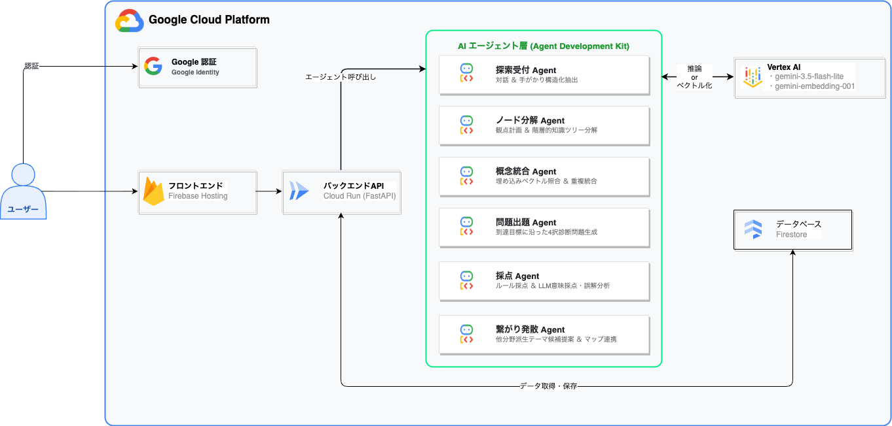
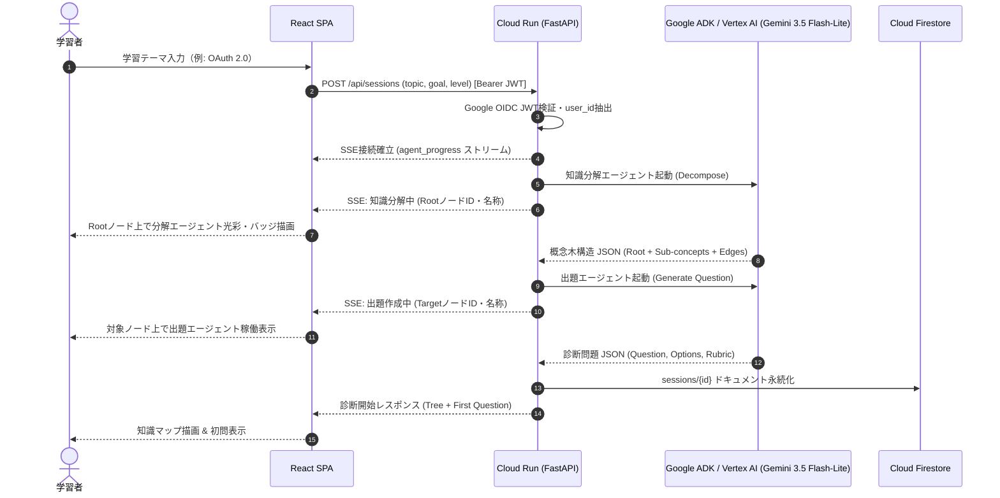
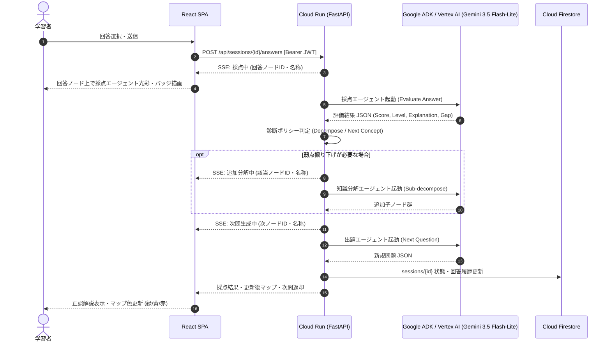
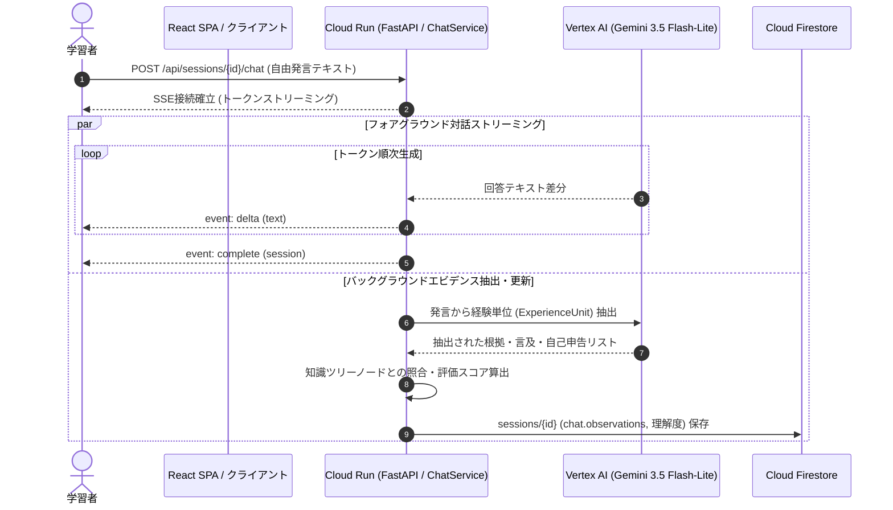

# 理解の地図（Knowledge Gap Mapper）基本設計書

## 1. システム概要

### 1.1 システム目的

本システムは、学習者が任意のトピックについて自身の「知識の抜け漏れ（Knowledge Gap）」を特定・解消するための自律型診断・探索プラットフォームである。
最新の超低レイテンシ基盤モデル（Gemini 3.5 Flash-Lite）およびエージェント基盤（Agent Development Kit: ADK）を用いて概念の木構造分解、4択適応型テスト出題、回答採点・解説生成、および関連分野への発散的展開を提供する。

### 1.2 システム構成概要

**本番技術スタック (Google Cloud Platform)**:
- **フロントエンド**: React 18, TypeScript, Vite, Vanilla CSS (Firebase Hosting 配信)
- **バックエンド**: Cloud Run (FastAPI, Python 3.12, Uvicorn)
- **AI / マルチエージェント基盤**: Google Cloud Vertex AI / Agent Development Kit (ADK) (Gemini 3.5 Flash-Lite)
- **埋め込みモデル**: Vertex AI Embeddings (`gemini-embedding-001`)
- **データベース**: Google Cloud Firestore (Native NoSQL Mode)
- **認証・認可**: Google Identity Services (GIS / OAuth 2.0 / OIDC JWT)

---

## 2. システム構成設計

### 2.1 システム構成図

### 2.2 システムコンポーネント詳細

| コンポーネント | プラットフォーム / 技術 | 主な役割・責務 |
| --- | --- | --- |
| **クライアント** | Webブラウザ (React SPA) | Google GIS ログインUI、知識ツリー可視化（SSE連動エージェント稼働ノードリアルタイム描画）、4択診断UI、正誤解説表示 |
| **フロントエンド配信** | Firebase Hosting | ビルド済み静的アセット（SPA）のCDN配信（Cloud Runはバックエンド専用でスケール・トゥ・ゼロ）。APIはCloud Run URLへ直接呼び出し |
| **バックエンド API** | Cloud Run (FastAPI) | GIS OIDC JWT検証、`user_id` 別データ完全分離、ADK Runner 制御、SSE進捗イベント配信（実行ノードID/名称連携）、状態遷移管理 |
| **知識分解エージェント** | ADK / Vertex AI (Gemini 3.5 Flash-Lite) | 観点計画策定、子概念ツリー自動生成、次層先読み |
| **出題エージェント** | ADK / Vertex AI (Gemini 3.5 Flash-Lite) | 未評価Targetに対する4択問題生成、4択選択肢・解説作成 |
| **採点エージェント** | ADK / Vertex AI (Gemini 3.5 Flash-Lite) | 4択選択肢の正誤判定、実証知識・不足知識・知識ギャップの特定、解説生成 |
| **会話診断・エビデンス抽出サービス** | FastAPI / `ChatService` (Gemini 3.5 Flash-Lite) | 自由対話のSSEストリーミング応答、会話からの理解エビデンス（実体験・言及・自己申告）バックグラウンド自動抽出、ツリー理解度反映 |
| **概念統合エージェント** | ADK / Vertex AI (Gemini 3.5 Flash-Lite) | `gemini-embedding-001` による類似度判定、標準概念ノード作成・グラフ統合マージ |
| **データベース** | Cloud Firestore | `sessions`（ツリー・状態・会話State集約Doc）、`lineages`、`relations`、`divergence_candidates` 永続化 |

---

## 3. データフロー設計

### 3.1 診断セッション開始・知識分解フロー

### 3.2 回答提出・評価・適応型分岐フロー

### 3.3 会話診断・エビデンス自動抽出フロー

---

## 4. 画面一覧・UI構成

| 画面名 | URLパス | 役割・機能概要 |
| --- | --- | --- |
| 診断・探索画面 | `/` | テーマ入力、知識ツリー描画、4択適応型テスト出題・回答、概念手動追加・分解 |
| 会話診断パネル | `/` (会話で確認タブ) | AIアシスタントとの自由対話、SSEストリーミング返答、抽出エビデンス・観察ログ表示 |
| マップ一覧画面 | `/` (マップタブ) | ユーザーが作成した全学習マップのカード一覧表示、削除、タイトル・スコープ編集 |
| 系統樹可視化画面 | `/` (系統タブ) | 親マップから派生マップへの分岐履歴（Lineage）を階層ツリーで可視化 |
| 知識ノード一覧画面 | `/` (ノードタブ) | 全マップ横断の概念一覧テーブル、理解度フィルタ（High/Med/Low）、検索・ソート |
| 理解度サマリー画面 | `/` (サマリータブ) | 全体・系統別・マップ別の理解度充足率プログレスバー、統計チャート表示 |

> ※ユーザーの具体的な画面操作手順、学習サイクル、ユースケース別の行動フローの詳細は [ユーザー利用フロー設計書.md](./ユーザー利用フロー設計書.md) を参照。

---

## 5. 認可・データ分離設計

### 5.1 Google IDトークン検証
- すべての保護対象APIリクエストについて、HTTPヘッダー `Authorization: Bearer <ID_TOKEN>` を受信。
- Google公開鍵証明書を用いてトークンの完全性・有効期限・Audienceを検証し、`user_id`（Google sub値）を確定。

### 5.2 Firestoreにおけるマルチテナント分離
- リポジトリ層において全クエリに `user_id == current_user` 条件を強制適用。
- 他ユーザーのセッション・マップ・系統への読み書きをサーバーサイドで完全に遮断。
