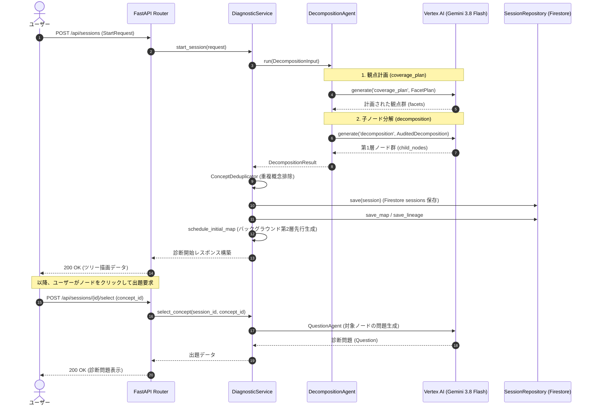

# 01. 知識分解・初期マップ構築 機能設計書

## 1. 機能概要

- ユーザーが入力した学習テーマ・詳細文脈を受け取り、LLM（Gemini 3.8 Flash / Vertex AI）を用いて体系的な階層的知識ツリー（ノードおよび有向エッジ）を自動生成する。
- 観点計画（`coverage_plan`）と子ノード生成（`decomposition`）の2段階生成を採用し、網羅的で偏りのない概念分解を実現する。
- 新規診断セッション（`sessions`）および知識マップ（`knowledge_maps` / `map_lineages`）を作成し、バックグラウンドで第2層の非同期並行先行生成（約25ノード）を開始する。
- **※ 出題問題の生成について**: 初期化時点では初問は自動生成されず、ユーザーがマップ上の概念ノードを選択（クリック）した段階で問題生成エージェント（`QuestionAgent`）がオンデマンド実行される。

## 2. 入出力

### 入力 (`StartRequest`)
- 学習テーマ (`theme`): 文字列 (例: "機械学習の基礎")
- 詳細文脈 (`domain_context`): 文字列 (任意、学習対象や背景の補足)
- プロバイダモード (`mode`): `gemini` (デフォルト)
- 探索モード (`exploration_mode`): `manual` (手動探索・デフォルト) / `auto` (自動進行)
- 手動フロー種別 (`manual_flow`): `decomposition_first` (事前分解優先・デフォルト) / `question_first` (出題優先)
- 解答形式 (`answer_format`): `choice_only` (選択肢のみ) / `mixed` (自由記述含む)
- ユーザー識別子 (`user_id`): 認証ユーザーID または `guest_user`

### 出力
- セッションID (`session_id`)
- 構築された知識ツリー (`knowledge_tree`)
  - ルートノードおよび第1層主要概念ノード群（ID, 名称, 説明, 理解度ステータス: `unknown`）
  - 前提関係を表すエッジリスト
- セッションメタデータ（初期表示深度 `initial_visible_depth`, 進捗状態等）
- ※ `current_question`: 初期セッション開始時は `null`（ノード選択時に生成）

## 3. 処理フロー

1. **リクエストバリデーション**:
   - `theme` が空文字でないか検証。
2. **2段階知識分解 (DecompositionAgent)**:
   - **観点計画 (`coverage_plan`)**: テーマから横方向に必要な切り口（課題・データ・評価・適用等）を計画。
   - **子項目生成 (`decomposition`)**: 計画観点に沿って第1層の主要概念ノード群（3〜5件）を生成し整合性検査。
3. **重複概念排除 (ConceptDeduplicator)**:
   - 既存の知識ツリーと同一概念の重複がないか正規化。
4. **永続化**:
   - Firestoreの `sessions`, `knowledge_maps`, `map_lineages` コレクションへ保存。
5. **バックグラウンド先行生成 (`schedule_initial_map`)**:
   - 第1層各ノードの子ノード（第2層、全体で約25ノード）を非同期並列で先行生成開始。
6. **レスポンス返却と待機**:
   - 初期知識ツリーデータをフロントエンドへ返却。この時点では出題は行わず、ユーザーのノード選択（クリック）を待機。

## 4. バリデーション

- `theme` が未指定または空白文字のみの場合、エラー。
- 生成された子ノード数が `initial_max_children`（デフォルト5）の範囲外の場合、リトライ。

## 5. エラーハンドリング

| エラーケース | ステータスコード | レスポンス例 | 備考 |
| --- | --- | --- | --- |
| テーマ未入力 | 400 | `{"detail": "学習テーマを入力してください。"}` | バリデーションエラー |
| LLM推論タイムアウト / 制限 | 503 | `{"detail": "AIサービスの応答がありませんでした。時間を置いて再試行してください。"}` | LLMError |
| DB書き込み失敗 | 500 | `{"detail": "セッションの永続化に失敗しました。"}` | 内部サーバーエラー |
