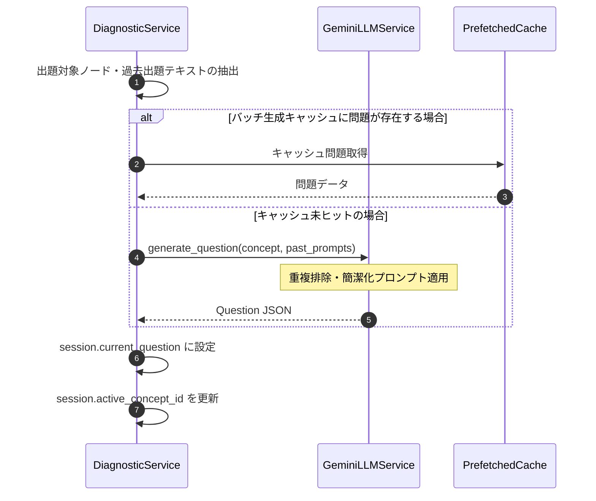

# 02. 診断問題生成 機能設計書

## 1. 機能概要

- 知識ツリー上の対象ノードについて、概念の定義・動作原理・応用に関する診断テスト問題を動的生成する。
- 問題文の冗長化を防止し、簡潔かつ的確な問いと選択肢を出力する。
- 過去の出題履歴を参照し、同一概念に対する重複出題を排除する。
- バッチ生成キャッシュを活用し、高速な出題レスポンスを実現する。

## 2. 入出力

### 入力
- セッション状態 (`Session`)
- 対象概念ノード (`ConceptNode`: ID, 名称, 説明, 階層深さ)
- 過去の出題履歴 (`List[HistoryItem]`)
- 問題タイプ指示 (選択式 `multiple_choice` / 自由記述 `free_text`)

### 出力
- 診断問題オブジェクト (`Question`)
  - 問題ID (`question_id`)
  - 概念ID (`concept_id`)
  - 簡潔な問題文 (`prompt`: 100〜150文字程度)
  - 選択肢リスト (`options`: 3〜4個の選択肢とID)
  - 模範解答・採点基準ルーブリック (`rubric`)

## 3. 処理フロー

1. **出題対象ノードのコンテキスト抽出**:
   - 概念の名称、説明、親ノード名、および過去にこのノードに関して出題された問題プロンプト一覧を収集。
2. **LLMプロンプトの適用（重複防止・文字数制限）**:
   - システム指示として「問題文は過度に長くせず100〜150文字程度で簡潔に出題すること」「過去の出題内容と論点が重複しない新しい切り口（定義・仕組み・ユースケース）から問うこと」を指定。
3. **構造化JSON生成**:
   - Geminiの構造化出力機能（Pydantic SchemaまたはJSON mode）を用いて `Question` モデルを生成。
4. **セッション反映**:
   - 生成された問題をセッションの `current_question` にセットし、DBへ保存。

## 4. バリデーション

- 生成された問題文および選択肢が空でないこと。
- 選択肢が最低3つ以上存在すること（選択式の場合）。
- 過去の履歴と問題文の類似度が一定値以下であること。

## 5. エラーハンドリング

| エラーケース | ステータスコード | レスポンス例 | 備考 |
| --- | --- | --- | --- |
| 対象ノードが存在しない | 404 | `{"detail": "指定された概念が見つかりません。"}` | ノード指定不正 |
| LLM生成失敗 / JSON構文不正 | 503 | `{"detail": "問題生成に失敗しました。再試行してください。"}` | フォールバック問題適用 |
