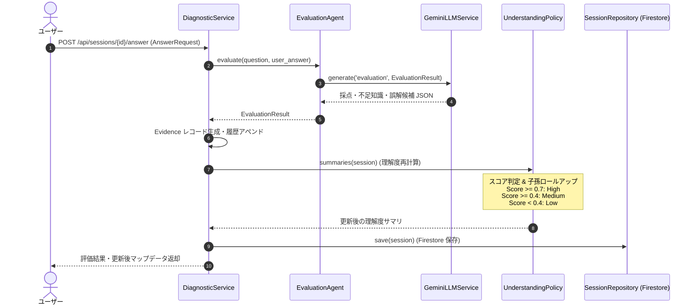

# 03. 回答評価・理解状態更新 機能設計書

## 1. 機能概要

- ユーザーが送信した回答（選択肢IDまたは自由記述テキスト）をLLM（EvaluationAgent）がリアルタイム採点する。
- 判定結果（`correct`, `partially_correct`, `incorrect`, `ungradable`）、スコア（0.0〜1.0）、不足している知識（`missing_knowledge`）、および誤解候補（`misconception_candidates`）を出力する。
- 採点結果を `Evidence` として記録し、対象ノードの理解度ステータス（`high`, `medium`, `low`）および診断確信度（`diagnostic_confidence`）を更新する。

## 2. 入出力

### 入力 (`AnswerRequest`)
- セッションID (`session_id`)
- 回答対象の概念ID (`concept_id`)
- 問題ID (`question_id`)
- ユーザー回答 (`answer_text` または選択肢ID)

### 出力 (`AnswerResponse`)
- 評価結果 (`EvaluationResult`):
  - 正誤分類 (`correctness`: `correct` / `partially_correct` / `incorrect` / `ungradable`)
  - スコア (`score`: float 0.0〜1.0)
  - 解説・フィードバック (`explanation`)
  - 不足知識リスト (`missing_knowledge`)
  - 誤解分析 (`misconception_candidates`)
- 更新された理解度サマリ (`understanding_summary`: 各ノードの level, score, confidence)
- 次の推奨アクション (`next_action`)

## 3. 処理フロー

1. **回答評価の実行 (EvaluationAgent)**:
   - 出題時の問題文・正解・評価基準（ルーブリック）とユーザー回答を照合し、LLMで構造化採点。
2. **証拠（Evidence）の蓄積**:
   - 正誤、スコア、不足知識、誤解を `session.evidence` に記録。
3. **理解度ステータスの算出 (UnderstandingPolicy)**:
   - 出題回答（Evidence）が存在する場合: 回答平均スコアおよび診断確信度を算出。
     - スコア $S \ge 0.7 \rightarrow$ `high`
     - $0.4 \le S < 0.7 \rightarrow$ `medium`
     - $S < 0.4 \rightarrow$ `low`
   - 未出題で事前自己評価（SelfAssessment）がある場合:
     - `high`: 仮スコア 0.9 / 確信度 0.25
     - `medium`: 仮スコア 0.55 / 確信度 0.25
     - `low`: 仮スコア 0.2 / 確信度 0.25
   - いずれもない場合: `unknown`
4. **永続化**:
   - Firestoreのセッションレコードを更新保存。

## 4. バリデーション

- `answer_text` が空文字でないこと。
- 指定された `question_id` が現在の出題と一致すること。

## 5. エラーハンドリング

| エラーケース | ステータスコード | レスポンス例 | 備考 |
| --- | --- | --- | --- |
| 回答対象問題の不一致 | 400 | `{"detail": "出題中の問題IDと一致しません。"}` | 整合性エラー |
| LLM評価失敗 | 503 | `{"detail": "回答評価に失敗しました。再試行してください。"}` | LLMError |
| セッション不在 | 404 | `{"detail": "セッションが見つかりません。"}` | セッションID不正 |
