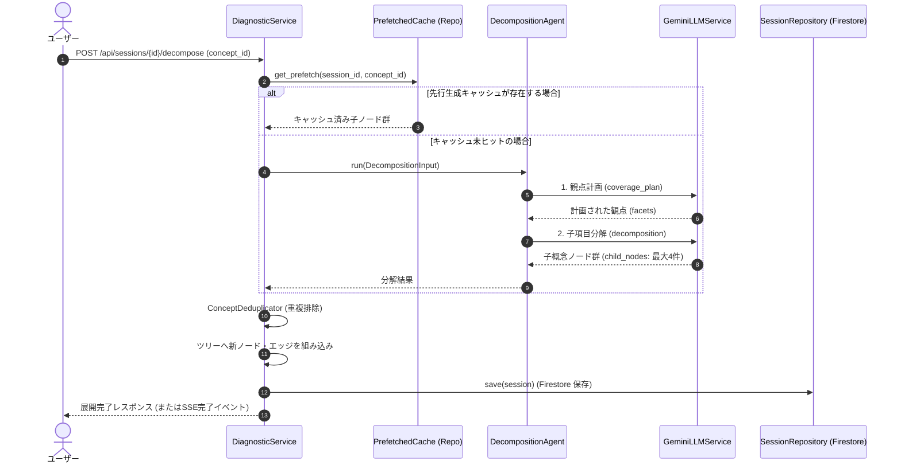

# 06. 概念手動分解 機能設計書

## 1. 機能概要

- ユーザーが特定の概念ノードを選択し、「この概念をさらに詳しく知りたい」「より細かく学びたい」と手動で分解（Decompose）を指示した際、直下に複数のサブ概念ノード（子ノード群）を生成・追加する。
- 観点計画（`coverage_plan`）と子項目生成（`decomposition`）の2段階生成、または先行分解（Prefetch）キャッシュを活用し、高品質かつ高速な展開を実現する。
- 生成時に過去の誤答履歴（`mistake_details`）やつまずき箇所（`weak_targets`）をプロンプトへ注入し、学習者の弱点に特化した子ノードを優先生成する。

## 2. 入出力

### 入力 (`SelectConceptRequest`)
- セッションID (`session_id`)
- 分解対象の概念ノードID (`concept_id`)

### 出力
- 更新されたセッション全体（新ノード群が追加された `knowledge_tree`、新エッジ、更新後理解度サマリ）
- SSE（Server-Sent Events）進捗ストリーミング通知

## 3. 処理フロー

1. **先行生成キャッシュの確認**:
   - バックグラウンド先読みタスクにより既に生成済みの場合は即座にキャッシュを展開。
2. **2段階生成の実行 (未キャッシュ時)**:
   - 弱点・誤答履歴（`mistake_details`）を付与して観点計画を作成。
   - 上限 `expansion_max_children`（デフォルト4件）以内で子ノードを生成。
   - LLMが「これ以上分割不要」と判断した場合は `terminal`（末端ノード確定）として処理。
3. **重複排除とツリー統合**:
   - `ConceptDeduplicator` により類似概念のマージ・重複排除を行い、親ノード直下に子ノード群を追加。
4. **永続化**:
   - Firestoreのセッションを更新保存。

## 4. バリデーション

- 既に分解済みで子ノードが存在する場合の重複分解抑止。
- 存在しない `concept_id` の指定はエラー。

## 5. エラーハンドリング

| エラーケース | ステータスコード | レスポンス例 | 備考 |
| --- | --- | --- | --- |
| ノードが存在しない | 404 | `{"detail": "指定された概念が見つかりません。"}` | ID不正 |
| 分解生成エラー | 503 | `{"detail": "概念分解に失敗しました。再試行してください。"}` | LLMError |
