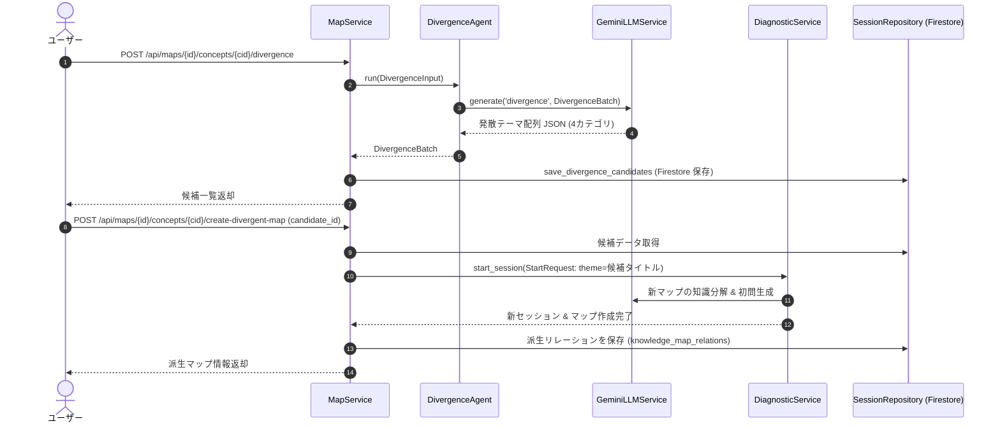

# 08. 発散テーマ提案・派生マップ作成 機能設計書

## 1. 機能概要

- 学習者が理解を深めた特定の概念ノードを起点として、LLM（DivergenceAgent）が4つの観点（実践応用、仕組み・内部機構、隣接分野、トラブル・リスク）から発展学習テーマの候補を動的提案する。
- ユーザーが候補を選択すると、そのテーマに基づいた新規知識マップを自動生成し、親マップ・親概念との間に派生リレーションを結び、系統樹（Lineage）を拡張する。

## 2. 入出力

### 発散候補生成 (Divergence Candidates)
- **入力**: 起点マップID (`map_id`), 起点概念ノードID (`concept_id`)
- **出力**: 候補リスト (`candidates`: 候補ID, タイトル, カテゴリ, スコープ, 学習理由)

### 派生マップ作成 (Create Divergent Map)
- **入力**: 親マップID (`map_id`), 親概念ノードID (`concept_id`), 発散候補ID (`candidate_id`)
- **出力**: 新規作成された派生マップID (`map_id`), 系統ID (`lineage_id`), マップタイトル, リレーション情報

## 3. 処理フロー

1. **発散テーマ生成プロンプトの実行 (DivergenceAgent)**:
   - 起点概念名および親マップの文脈に基づき、以下の4カテゴリで各テーマを生成:
     - `practical_application`: 実装パターン・実践的な開発での活用例
     - `underlying_mechanism`: プロトコル仕様・数学的基礎・内部動作の仕組み
     - `adjacent_field`: 類似技術・併用される周辺ツール・代替手段
     - `troubleshooting_risk`: セキュリティ脆弱性・典型的な設計ミス・障害対策
2. **候補の永続化**:
   - Firestore の `divergence_candidates` コレクションへ保存。
3. **派生マップの自動生成**:
   - ユーザーが候補を選択すると、新セッションとして `DiagnosticService.start_session` を呼び出し、知識ツリーを自動構築。
4. **リレーションの構築**:
   - 親マップと子マップの親子関係、起点概念ID、カテゴリ、学習理由を記録。
   - 子マップは親マップの系統ID（`lineage_id`）を引き継ぎ、系統樹を拡張。

## 4. バリデーション

- 起点となる概念ノードが親マップ内に存在すること。
- 存在しない候補IDの指定はエラー。

## 5. エラーハンドリング

| エラーケース | ステータスコード | レスポンス例 | 備考 |
| --- | --- | --- | --- |
| 候補が見つからない | 404 | `{"detail": "指定された発散候補が見つかりません。"}` | 候補ID不正 |
| 派生生成失敗 | 503 | `{"detail": "派生マップの生成に失敗しました。"}` | LLMError |
