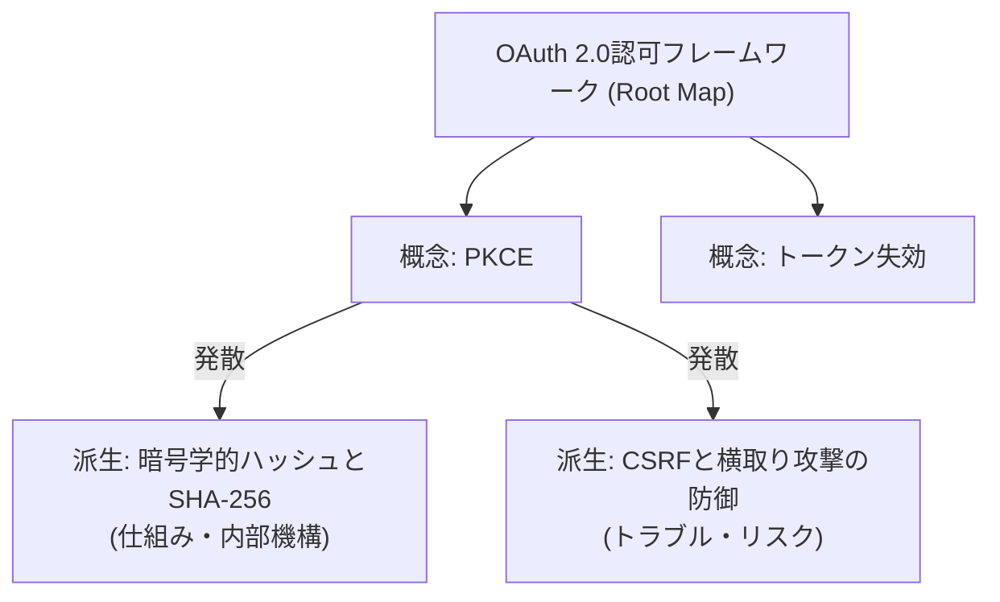

# 09. マップ系統可視化 機能設計書

## 1. 機能概要

- 起点となったルートマップと、そこから発散・派生したすべての子マップ、孫マップの関係性を系統樹（Lineage Tree）として構造化・可視化する。
- ユーザーは自身がどのように探究の幅を広げてきたかの学習の系譜を俯瞰し、任意の派生マップへジャンプできる。

## 2. 入出力

### 入力
- 系統ID (`lineage_id`) または 系統一覧取得指示

### 出力
- 系統一覧: 全系統のルートマップ名、所属マップ数、最終更新日
- 系統詳細:
  - 系統ID (`lineage_id`)
  - ルートマップID (`root_map_id`)
  - 系統タイトル (`title`)
  - 所属マップ配列 (`maps`: ID, タイトル, スコープ, ルートフラグ)
  - 派生関係配列 (`relations`: 親マップID, 子マップID, 親概念ID, 発散カテゴリ, リレーション要約)

## 3. 処理フロー

1. **系統レコード取得**:
   - `map_lineages` テーブルから `lineage_id` に一致するレコードを取得。
2. **所属マップ群の抽出**:
   - `knowledge_maps` テーブルから `lineage_id` が一致する全マップを取得。
3. **エッジ（リレーション）の解決**:
   - 各マップについて `knowledge_map_relations` テーブルを照会し、親マップ・起点概念・発散理由を紐付け。
4. **グラフ構造化**:
   - フロントエンドで描画しやすいよう、ノード一覧（Maps）とリンク一覧（Relations）に構造化して返却。

## 4. バリデーション

- `lineage_id` が存在すること。

## 5. エラーハンドリング

| エラーケース | ステータスコード | レスポンス例 | 備考 |
| --- | --- | --- | --- |
| 系統が存在しない | 404 | `{"detail": "指定された系統が見つかりません。"}` | 存在チェック |
