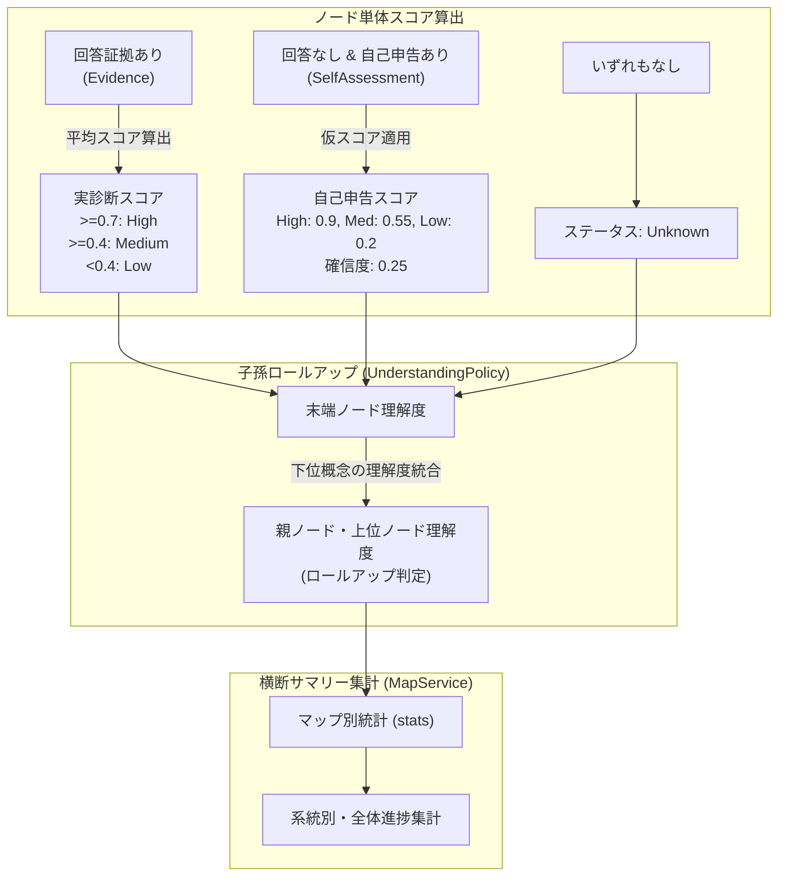

# 10. 理解度集計・横断ロールアップ 機能設計書

## 1. 機能概要

- 全システム、系統別、個別マップ別の3階層において、知識ノードの理解度ステータス（High, Medium, Low, Unknown）を集計し、理解度充足率（High比率）や受検進捗率を算出する。
- 各ノードの理解度は、出題への回答証拠（`evidence`）と事前の自己申告（`self_assessments`）を組み合わせ、親ノード・子孫ノードへボトムアップにロールアップ（`summaries`）して算出する。

## 2. 入出力

### 入力
- 集計スコープ指示: 全体 (`all`), 系統別 (`lineage_id`), マップ別 (`map_id`)

### 出力
- 理解度集計統計 (`UnderstandingSummary`):
  - 総ノード数 (`total_concepts`)
  - 理解度内訳 (`high_count`, `medium_count`, `low_count`, `unknown_count`)
  - High充足率 (`high_ratio`: 0.0〜1.0)
  - 診断実施率 (`tested_ratio`: 0.0〜1.0)
  - 集計対象マップ数・系統数

## 3. 処理フロー

1. **セッションデータのロード**:
   - Firestoreより指定スコープのセッションツリー、`evidence`、`self_assessments` を取得。
2. **ノード直接スコアの算出 (`UnderstandingPolicy.summaries`)**:
   - 回答実績があるノードは問題得点からスコアを算出。
   - 未回答かつ自己評価があるノードは定数（`high: 0.9`, `medium: 0.55`, `low: 0.2`）で仮推定。
3. **ツリー全体のロールアップ**:
   - 子ノードの理解度を集約し、親ノードのステータスをボトムアップで算出。
4. **横断指標の計算**:
   - $\text{high\_ratio} = \frac{\text{high\_count}}{\text{total\_concepts}}$
   - $\text{tested\_ratio} = \frac{\text{total\_concepts} - \text{unknown\_count}}{\text{total\_concepts}}$

## 4. バリデーション

- 総ノード数が0件の場合、ゼロ除算を防止し各比率を0.0として処理。

## 5. エラーハンドリング

| エラーケース | ステータスコード | レスポンス例 | 備考 |
| --- | --- | --- | --- |
| 指定された系統またはマップが存在しない | 404 | `{"detail": "指定された対象が見つかりません。"}` | 存在チェック |
