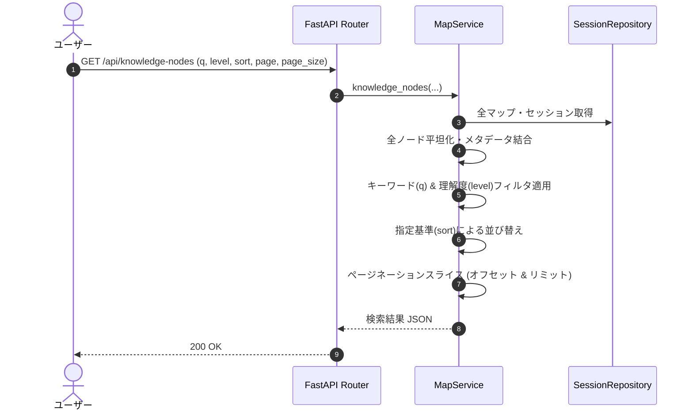

# 11. 知識ノード横断検索 機能設計書

## 1. 機能概要

- ユーザーが作成した全マップに存在するすべての概念ノードをデータベースから横断集約し、キーワード検索、理解度レベルによる絞り込み、各種ソート（優先度順、理解度順、名前順、更新日順）、ページネーション付きで一覧表示・閲覧できるようにする。
- 弱点（理解度Low）ノードの一括洗い出しや、ピンポイント復習を強力に支援する。

## 2. 入出力

### 入力
- 検索キーワード (`q`): 文字列 (部分一致、最大200文字)
- マップ絞り込み (`map_id`): マップID (任意)
- 理解度レベル (`level`): `all` / `high` / `medium` / `low` / `unknown` / `mixed`
- ソート順 (`sort`): `priority` / `understood` / `name` / `recent` / `questions`
- ページ番号 (`page`): 1以上の整数
- 1ページ件数 (`page_size`): 1〜100の整数

### 出力
- 総件数 (`total`)
- 現在ページ (`page`), ページサイズ (`page_size`)
- 知識ノード配列 (`nodes`):
  - ノードID, マップID, マップタイトル, 概念名, 説明, 理解度, 正答率, 出題問題数, 最終診断日

## 3. 処理フロー

1. **ノードの平坦化**:
   - 全セッションツリーのノードを展開し、所属するマップのタイトルや系統IDを付与。
2. **フィルタリング**:
   - `q`: 概念名または説明文にキーワードが含まれるか照合（大文字小文字不問）。
   - `level`: `all` 以外の場合、`node.understanding == level` で絞り込み。
3. **ソーティング**:
   - `priority`: 知識ギャップ優先（Low > Unknown > Medium > High）。
   - `understood`: 理解済み（High > Medium > Low > Unknown）順。
   - `recent`: 最終診断日の新しい順。
4. **ページネーション**:
   - `offset = (page - 1) * page_size` から `page_size` 件を切り出して返却。

## 4. バリデーション

- `page` $\ge 1$、`page_size` は 1〜100 の範囲。
- `level`, `sort` は定義済みEnum値のみ許可。

## 5. エラーハンドリング

| エラーケース | ステータスコード | レスポンス例 | 備考 |
| --- | --- | --- | --- |
| ページネーション引数不正 | 422 | `{"detail": "page_size must be between 1 and 100"}` | FastAPI自動バリデーション |
