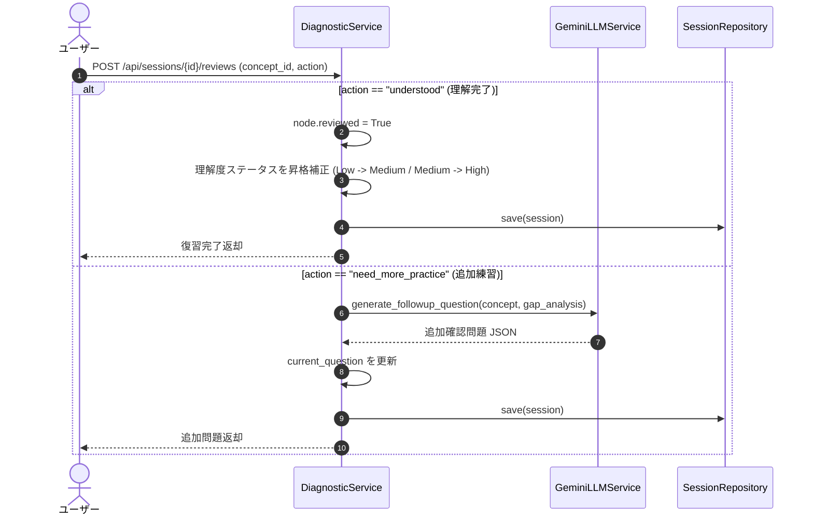

# 13. 回答復習・追加確認 機能設計書

## 1. 機能概要

- 回答後に学習者が採点フィードバックや知識ギャップ分析をじっくり確認し、「理解できた（復習完了）」または「さらに類題で練習したい（追加確認）」を選択して学習を定着させる機能。
- ユーザーの復習アクションを履歴に記録し、理解度ステータスを確実な定着（High）へと昇格させる。

## 2. 入出力

### 入力
- セッションID (`session_id`)
- 対象概念ノードID (`concept_id`)
- 復習アクション (`action`: `understood` / `need_more_practice`)

### 出力
- 復習完了メッセージ
- 更新された復習ステータス
- （`need_more_practice` の場合）追加の演習確認問題

## 3. 処理フロー

1. **復習アクションの検証**:
   - `understood` または `need_more_practice` を判定。
2. **理解完了時のステータス更新**:
   - 解説を読了して理解できた場合、ノードのレビュー完了フラグを立て、理解度判定を1段階引き上げる。
3. **追加演習の生成**:
   - まだ不安がある場合、直前の `gap_analysis`（弱点）をプロンプトに注入して、弱点を克服するためのピンポイントな追加確認問題をLLMが生成。

## 4. バリデーション

- `action` が規定値以外の場合は 400 Bad Request。
- `concept_id` がセッションツリー内に存在すること。

## 5. エラーハンドリング

| エラーケース | ステータスコード | レスポンス例 | 備考 |
| --- | --- | --- | --- |
| 無効なアクション種別 | 400 | `{"detail": "無効な復習アクションです。"}` | バリデーションエラー |
| ノードが存在しない | 404 | `{"detail": "指定された概念ノードが見つかりません。"}` | 存在チェック |
