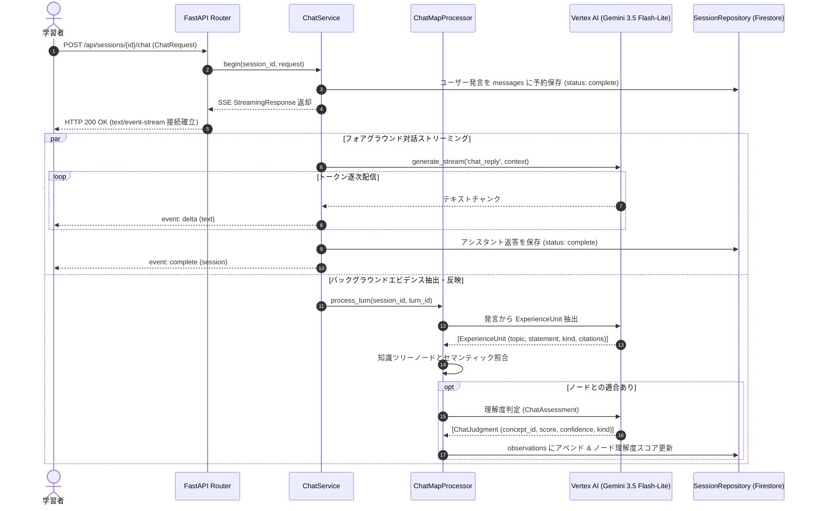

# 14. 会話診断 機能設計書

## 1. 機能概要

- 学習者が自然言語（自由文）で疑問や自身の理解・実体験をAIアシスタントに送信し、対話形式で理解を深める自由対話インターフェースを提供する。
- **フォアグラウンドストリーミング**: Server-Sent Events (SSE) を用いてAIの思考・回答テキストをリアルタイムで逐次配信する。
- **バックグラウンドエビデンス自動抽出 & ツリー更新**:
  - 発言テキストから「経験単位 (`ExperienceUnit`)」（実体験、言及、自己申告、理解ギャップ）をAIが自動抽出。
  - 知識ツリー上のノードと照合し、根拠のある理解度観察記録 (`ChatObservation`) を生成してツリーの理解度スコアを自動更新する。
- **会話スレッド管理**: 概念や話題ごとに独立した会話スレッドを複数作成・切り替え可能。
- **過去ログ再スキャン (Reprocess)**: ユーザーが後からノードを追加・分解した際、過去の全発言ログを再スキャンして未評価ノードに対する理解エビデンスを自動再判定する。

## 2. 入出力

### メッセージ送信 (`ChatRequest`)
- **入力**:
  - セッションID (`session_id`)
  - 発言ID (`message_id`: 必須, 英数字・ハイフン・アンダースコア)
  - 発言テキスト (`content`: 必須, 1〜100,000文字)
  - 注目概念ID (`concept_id`: 任意)
  - 会話スレッドID (`conversation_id`: 任意)
- **出力** (`text/event-stream`):
  - `phase`: 処理段階通知
  - `delta`: 逐次生成される回答テキスト（`message_id`, `text`）
  - `complete`: 応答完了通知（`session` オブジェクト）
  - `error`: 生成失敗通知（`message`）

### 会話履歴・状態取得
- **入力**: セッションID (`session_id`)
- **出力**: セッション全体のパブリック状態（`session.chat` に蓄積されたメッセージ履歴、エビデンス一覧、ジョブ進捗）

### 新規会話スレッド開始 (`NewConversationRequest`)
- **入力**: セッションID (`session_id`), 会話スレッドID (`conversation_id`: 任意)
- **出力**: 新規スレッドが作成されたセッション情報

### 会話再処理 (`POST /chat/reprocess`)
- **入力**: セッションID (`session_id`)
- **出力**: バックグラウンド再スキャンジョブがスケジュールされたセッション情報

## 3. 処理フロー

### 処理詳細

1. **二重送信・排他制御**:
   - `foreground_turn_id` または生成中タスクが存在する場合、重複送信として `409 Conflict` を返却。
   - 同一 `message_id` かつ同一内容の再送時は、保存済み返答をリプレイ配信。
2. **根拠の厳密検証**:
   - 抽出された引用（`citations`）が、ユーザーの実際の発言内容と完全一致しているかをサーバーサイドで機械検証。幻覚（ハルシネーション）による不正な引用を排除。
3. **経験と自己申告の重み付け**:
   - 学習者が「〜を使った経験がある」と発言した場合は `self_report`（最大スコア 0.6、信頼度 0.25）として記録し、客観テストと同等の満点判定は行わない安全設計。

## 4. バリデーション & 制約事項

- 発言テキストは最大100,000文字。
- 同時に実行できるバックグラウンド抽出ジョブ数はセマフォにより並行度を制御（デフォルト設定値に準拠）。
- 診断完了済みのセッションでは新規発言を禁止。

## 5. エラーハンドリング

| エラー事象 | ステータスコード | 応答メッセージ / 対処 |
|---|---|---|
| セッション不在 | 404 Not Found | `{"detail": "指定されたセッションが存在しません。"}` |
| 返答生成中の連続送信 | 409 Conflict | `{"detail": "返答を生成中です。完了してから送信してください。"}` |
| 完了済みセッションでの発言 | 400 Bad Request | `{"detail": "進行中の深掘りマップで会話してください。"}` |
| LLM呼び出しエラー | 500 / SSE error | SSEストリーム上でエラーイベントを送信し、メッセージ状態を `failed` に更新 |
