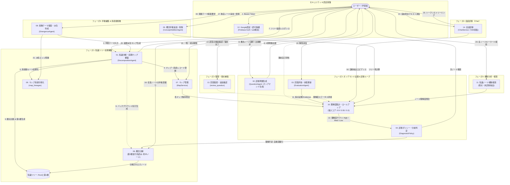

# 理解の地図（Knowledge Gap Mapper）機能設計書一覧

## 1. 概要

本ディレクトリには、AI学習診断システム「理解の地図（Knowledge Gap Mapper）」を構成する全14機能の機能設計書が格納されています。  
システムは、ユーザーが入力した学習テーマから自律的に階層的知識ツリーを構築し、適応型テスト（Adaptive Testing）による診断、弱点分析、手動深掘り、そして派生マップへの発散探索（Lineage Tree）を提供します。  
LLM基盤モデルには Google Cloud Vertex AI の **Gemini 3.8 Flash**（`gemini-3.8-flash`）を採用しています。

---

## 2. 機能一覧と設計書リンク

| No. | 機能設計書 | 担当サービス / エージェント | 主な役割 |
|---|---|---|---|
| **01** | [01. 知識分解・初期マップ構築 機能設計書](./01_知識分解・初期マップ構築機能設計書.md) | `DecompositionAgent` `DiagnosticService` | 観点計画・概念分解の2段階生成、第2層先行生成（出題は行わずマップ構築に特化） |
| **02** | [02. 診断問題生成 機能設計書](./02_診断問題生成機能設計書.md) | `QuestionAgent` `QuestionGenerationAgent` | ノード選択時の動的出題、簡潔な4択問題生成、重複排除 |
| **03** | [03. 回答評価・理解状態更新 機能設計書](./03_回答評価・理解状態更新機能設計書.md) | `EvaluationAgent` `UnderstandingPolicy` | リアルタイム採点、不足知識・誤解抽出、Evidence記録 |
| **04** | [04. 診断ポリシー・分岐判定 機能設計書](./04_診断ポリシー・分岐判定機能設計書.md) | `DiagnosticPolicy` | 採点結果に応じた次ノード選定・適応型自動深掘り判定 |
| **05** | [05. 概念手動追加 機能設計書](./05_概念手動追加機能設計書.md) | `ConceptAdditionAgent` `DiagnosticService` | ユーザー独自ノードの追加 |
| **06** | [06. 概念手動分解 機能設計書](./06_概念手動分解機能設計書.md) | `DecompositionAgent` `DiagnosticService` | 任意ノードの手動深掘り、先読みキャッシュ展開 |
| **07** | [07. マップ管理 機能設計書](./07_マップ管理機能設計書.md) | `MapService` | マップ一覧・詳細取得、統計情報、削除カスケード |
| **08** | [08. 発散テーマ提案・派生マップ作成 機能設計書](./08_発散テーマ提案・派生マップ作成機能設計書.md) | `DivergenceAgent` `MapService` | 4観点からの発展テーマ提案、派生マップ自律構築 |
| **09** | [09. マップ系統可視化 機能設計書](./09_マップ系統可視化機能設計書.md) | `MapService` | 親子マップのリレーション構造化、系統樹（Lineage）描画 |
| **10** | [10. 理解度集計・横断ロールアップ 機能設計書](./10_理解度集計・横断ロールアップ機能設計書.md) | `UnderstandingPolicy` `MapService` | ノード自己評価・出題証拠の子孫ロールアップ集計 |
| **11** | [11. 知識ノード横断検索 機能設計書](./11_知識ノード横断検索機能設計書.md) | `MapService` | 全マップ横断の概念検索、弱点ノード一括抽出 |
| **12** | [12. Google認証・認可保護 機能設計書](./12_Google認証・認可保護機能設計書.md) | `auth.py` `FastAPI Depends` | Firebase/Google Auth トークン検証、マルチテナント保護 |
| **13** | [13. 回答復習・追加確認 機能設計書](./13_回答復習・追加確認機能設計書.md) | `DiagnosticService` | 過去の誤答の再確認、復習完了による理解度昇格 |
| **14** | [14. 会話診断 機能設計書](./14_会話診断機能設計書.md) | `ChatService` `ChatMapProcessor` | 自由対話のSSEストリーミング、会話からのエビデンス自動抽出・ツリー理解度反映 |

---

## 3. 全体機能連携図 (Architecture & Data Flow)

各機能がどのように連携して初期化・診断・探索・横断管理を構成しているかを示します。

---

## 4. 機能間データ連携マトリクス

| 連携元 | 連携先 | 授受されるデータ | 目的 |
|---|---|---|---|
| **12 (認証)** | **全機能 (01〜14)** | `user_id`, Bearerトークン検証結果 | ユーザー単位のデータ分離・セキュリティ保護 |
| **01 (初期構築)** | **07 (マップ管理)** | `map_id`, `theme`, `initial_visible_depth` | マップレコードの登録と初期表示深度の設定 |
| **01 (初期構築)** | **09 (系統可視化)** | `lineage_id`, `root_map_id` | 新規学習系統樹のルート登録 |
| **ユーザー選択** | **02 (問題生成)** | 対象概念ノードID (`concept_id`) | **ノード選択時にオンデマンドで診断問題を生成** |
| **02 (問題生成)** | **03 (回答評価)** | `Question` (問題文、正解、ルーブリック) | 正誤判定および不足知識・誤解分析の基準データ |
| **03 (回答評価)** | **10 (集計)** | `Evidence` (正誤、得点、不足知識、誤解) | ノード直接理解度スコアの算出 |
| **10 (集計)** | **04 (ポリシー判定)** | 理解度サマリ (`level`, `confidence`) | 適応型学習における次アクション（進行 / 分解 / 完了）の判定 |
| **04 (ポリシー判定)** | **06 (概念分解)** | 弱点ノード (`concept_id`) | 理解不足ノードの自動下位分解・原因切り分け |
| **05 (概念追加/削除)** | **10 (集計)** | 更新後の `KnowledgeTree` | 編集後のツリー全体のロールアップ再計算 |
| **06 (概念分解)** | **10 (集計)** | 新規追加された子ノード群 | 分解ノード群の初期ステータス反映 |
| **14 (会話診断)** | **10 (集計)** | `ChatObservation` (抽出された理解度根拠) | 会話から抽出したエビデンスに基づくノード理解度更新 |
| **08 (発散作成)** | **01 (初期構築)** | 候補タイトル (`theme`), 起点概念コンテキスト | 新規派生マップの自動構築 |
| **08 (発散作成)** | **09 (系統可視化)** | `source_map_id`, `target_map_id`, `relation` | 同一系統樹内における派生エッジの追加 |
| **07 (マップ管理)** | **10 (集計)** | 各セッションツリー | マップ一覧表示用の進捗統計 (`stats`) 集計 |
| **11 (横断検索)** | **10 (集計)** | 全マップの概念ノード | 横断的な理解度フィルタ（Lowノード一括抽出等） |
| **13 (回答復習)** | **10 (集計)** | 復習完了フラグ (`reviewed`) | 理解度ステータスの昇格補正 |
